# DRAW FOR FIGHT (D4F) — DEVELOPMENT ROADMAP

This roadmap defines the 10-phase incremental development lifecycle for **Draw for Fight**, a 3D multiplayer creative competition game powered by **Godot Engine 4.x** (GL Compatibility renderer + Jolt 3D Physics) for Windows 10/11 x64 and itch.io distribution.

---

## Roadmap Overview

```mermaid
flowchart LR
    P1["Phase 1: Foundation & 3D Prototype"] --> P2["Phase 2: Character & Vehicle Drawing"]
    P2 --> P3["Phase 3: 3D Physics & Competition Prototype"]
    P3 --> P4["Phase 4: Collaborative 3D Map Editor"]
    P4 --> P5["Phase 5: First Playable Competition Mode"]
    P5 --> P6["Phase 6: Self-Hosted Multiplayer"]
    P6 --> P7["Phase 7: 8-Layer Security & 8-Player Support"]
    P7 --> P8["Phase 8: Additional Competition Modes"]
    P8 --> P9["Phase 9: Optimization, AI & QA"]
    P9 --> P10["Phase 10: Windows 10/11 & itch.io Release"]
```

---

## Detailed Milestones

### Phase 1: Godot Foundation & 3D Prototype
- **Objective**: Establish the mandatory directory layout, core constants, serialization sanitizer, Autoload singletons (`GameManager`, `SettingsManager`, `AudioManager`), main scene router, and basic 3D test arena.
- **Deliverables**:
  - `project.godot` configured for Windows 10/11 x64 (`gl_compatibility` renderer, Jolt Physics, input actions).
  - `scripts/core/constants.gd`, `scripts/utilities/serializer.gd`, `scripts/managers/game_manager.gd`, `scripts/managers/settings_manager.gd`.
  - Root `scenes/main/main.tscn` and 11 screen navigation shells.
- **Acceptance Criteria**: Game launches cleanly into Main Menu, transitions between all 11 screens without errors, and saves/loads settings in `user://`.

### Phase 2: Character & Vehicle Drawing System
- **Objective**: Build the 2D drawing workshops for both Stickman Characters and Wheeled Vehicles with 2D-to-3D extrusion and mesh budgeting.
- **Deliverables**:
  - `scripts/core/creation_data.gd` with default Stickman and Sketch Racer templates.
  - `scripts/characters/drawing_canvas.gd` with freehand brush, color picker, thickness slider, part tags, eraser, undo/redo stack, and template guides.
  - `scripts/utilities/mesh_budget_limiter.gd` (Ramer-Douglas-Peucker simplification & vertex caps).
  - `scripts/physics/mesh_extruder_3d.gd` (`SurfaceTool` 2D-to-3D ribbon extrusion & collision shape generation).
  - `scenes/characters/character_workshop.tscn` and `scenes/vehicles/vehicle_workshop.tscn`.
- **Acceptance Criteria**: Players can draw, erase, undo/redo, preview in 3D, and save/load custom characters and vehicles to `user://creations/`.

### Phase 3: 3D Physics & Competition Prototype
- **Objective**: Turn extruded 3D creations into responsive, fair physics competitors with normalized attribute budgets.
- **Deliverables**:
  - `scripts/physics/physics_configurator.gd` (mass, speed, acceleration, grip, bounce, and knockback resistance balancing).
  - `scripts/characters/playable_character_3d.gd` (movement, jumping, shove/knockback impulse, checkpoint detection).
  - `scripts/vehicles/playable_vehicle_3d.gd` (arcade suspension, throttle, steering, drift/grip, ramp air control, boost).
- **Acceptance Criteria**: Drawn characters and vehicles move, jump, climb ramps, and collide predictably with fair attribute trade-offs.

### Phase 4: Collaborative 3D Map Editor
- **Objective**: Allow lobby participants to collaboratively build competition arenas using both top-down 2D extruded terrain strokes and direct 3D object placement.
- **Deliverables**:
  - `scripts/core/map_data.gd` and starter map JSON files in `data/maps/`.
  - `scripts/map_editor/collaborative_map_editor.gd` with object ownership, per-player quotas, preparation countdown timer, and host finalization lock.
  - `scripts/map_editor/map_validator.gd` preventing impossible gaps, missing spawns/finish lines, or griefed spawn hazards.
  - `scenes/map_editor/map_editor.tscn` and `scripts/ui/map_editor_ui.gd`.
- **Acceptance Criteria**: Multiple players can simultaneously place roads, platforms, ramps, walls, bridges, checkpoints, finish lines, and hazards; `MapValidator` blocks unfair/impossible layouts.

### Phase 5: First Playable Competition Mode (Race Competition MVP)
- **Objective**: Deliver a complete end-to-end match lifecycle with authoritative scoring and Race Competition mode.
- **Deliverables**:
  - `scripts/managers/match_manager.gd` (countdown, match timer, checkpoint progression, respawn, tie-breakers, rankings, rematch).
  - `scripts/competition/competition_mode_base.gd` and `scripts/competition/race_mode.gd`.
  - `scenes/arenas/competition_arena.tscn` and `scenes/competition/results_rankings.tscn`.
- **Acceptance Criteria**: Full match loop from Lobby → Map Editor → Preparation → 3D Race Competition → Results & Rankings → Rematch.

### Phase 6: Self-Hosted Multiplayer
- **Objective**: Enable the Host PC to act as an authoritative server while playing locally, supporting LAN and internet connections plus optional relay fallback.
- **Deliverables**:
  - `scripts/networking/network_manager.gd` (`ENetMultiplayerPeer`, LAN UDP broadcast discovery, reconnect token recovery).
  - `scripts/networking/state_interpolator.gd` (snapshot interpolation and client-side input prediction).
  - `scripts/networking/relay_connector.gd` (optional relay fallback when direct UDP NAT traversal fails).
  - `scenes/lobby/create_lobby.tscn`, `scenes/lobby/join_lobby.tscn`, `scenes/lobby/waiting_room.tscn`.
- **Acceptance Criteria**: Host creates lobby and plays simultaneously; joining players synchronize custom creations, map edits, and live 3D physics states.

### Phase 7: Eight-Layer Security Handshake & 8-Player Support
- **Objective**: Protect all multiplayer sessions with the mandatory 8-layer security handshake and verify 8-player concurrency.
- **Deliverables**:
  - `scripts/security/handshake_protocol.gd` (Layers 1–5: Lobby Auth, Secure Transport, Mutual Auth, 256-bit Challenge-Response, HKDF-SHA256 Session Keys).
  - `scripts/security/packet_cipher.gd` (Layer 6: AES-256-CBC + HMAC-SHA256 Encrypt-then-MAC).
  - `scripts/security/replay_rate_guard.gd` (Layer 7: 64-bit sliding window anti-replay & token-bucket rate limiting).
  - `scripts/security/session_validator.gd` (Layer 8: RBAC authorization, physics input clamping, payload sanitization).
  - `scripts/security/security_manager.gd`.
- **Acceptance Criteria**: Spoofed, replayed, tampered, rate-flooded, and unauthorized packets are deterministically rejected; 8-player sessions authenticate and synchronize cleanly.

### Phase 8: Additional Competition Modes
- **Objective**: Expand the modular competition system with Obstacle Survival, Physics Battle, and Custom Challenge modes.
- **Deliverables**:
  - `scripts/competition/obstacle_survival_mode.gd` (Mode B: elimination survival course).
  - `scripts/competition/physics_battle_mode.gd` (Mode C: sumo knockback brawler with kill attribution & lives).
  - `scripts/competition/custom_challenge_mode.gd` (Mode D: host-configurable gravity, lives, vehicles/characters, custom scoring weights).
- **Acceptance Criteria**: All 4 competition modes are selectable, playable, and tested with authoritative host scoring and tie-breakers.

### Phase 9: Optional AI Features, Optimization & QA
- **Objective**: Add modular, key-free AI design suggestions and NPC bot competitors, optimize mesh/network performance for low-to-mid-range PCs, and run white-box & black-box test suites.
- **Deliverables**:
  - `scripts/managers/ai_assistant_manager.gd` and `scripts/competition/ai_bot_controller.gd`.
  - Automated test runner (`tests/test_runner.gd`) and Python static/integration validators (`tools/validation/validate_project.py`).
  - Unit, integration, networking, security, gameplay, and performance tests under `tests/`.
- **Acceptance Criteria**: 100% pass rate across all automated white-box and black-box test scenarios; mesh vertex counts capped below budget.

### Phase 10: Windows 10/11 & itch.io Release Packaging
- **Objective**: Prepare Windows 10/11 x64 export presets, automated build/packaging scripts, and itch.io `butler` deployment tooling.
- **Deliverables**:
  - `export_presets.cfg` configured for Windows Desktop (`x86_64`).
  - `tools/build/build_windows.ps1` and `tools/build/publish_itch.ps1`.
  - Complete documentation traceability in `docs/`.
- **Acceptance Criteria**: Reproducible Windows x64 build & packaging workflow ready for itch.io distribution.
