# Draw for Fight (D4F) — System Architecture (`ARCHITECTURE.md`)

## 1. System Purpose
This document defines the high-level software architecture of **Draw for Fight (D4F)** in Godot Engine 4.x. It specifies the layered subsystem boundaries, the seven global Autoload singletons, directory organization, scene tree hierarchy, and engine configuration (`Jolt Physics` + `GL Compatibility` rendering pipeline).

---

## 2. Functional Requirements
- **FR-ARCH-01**: Provide decoupled global services via deterministic Autoload singletons initialized in strict dependency order.
- **FR-ARCH-02**: Support seamless transitions across all 11 application screens without memory leaks, orphaned physics bodies, or dropped network sockets.
- **FR-ARCH-03**: Allow any game instance to operate as Standalone (Single/Practice), Authoritative Listen-Server Host (`Peer ID = 1`), or Remote Joining Client (`Peer ID = 2..8`) using identical scene and script assets.
- **FR-ARCH-04**: Enforce strict separation between 2D/3D procedural generation (`res://scripts/creation/`), network transport/security (`res://scripts/network/`), and match rule evaluation (`res://scripts/gameplay/`).

---

## 3. Non-Functional Requirements
- **Modularity & Extensibility**: Adding a 5th competition mode or a new map hazard prop must require zero changes to `NetworkManager` or `SecurityManager`.
- **Deterministic Initialization**: Cold boot to Main Menu must complete in $< 3.0\text{ seconds}$ on standard SSD/HDD Windows 10/11 systems.
- **Memory Footprint**: Total resident memory (RAM + VRAM) during an 8-player match must stay below $650\text{ MB}$.

---

## 4. Inputs and Outputs
- **Inputs**:
  - `project.godot` engine configuration flags.
  - Persistent user files in `user://` (`settings.cfg`, `crypto_identity.dat`, `creations/*.json`, `maps/*.json`).
  - OS window/input events and UDP network sockets (`:42424` game traffic, `:42425` LAN broadcast discovery).
- **Outputs**:
  - Active 2D/3D Godot `SceneTree` hierarchy rendered at 60 FPS via `gl_compatibility`.
  - Encrypted multiplayer packet streams and sanitized JSON persistence files.

---

## 5. Components and Responsibilities

### 5.1 The Seven Autoload Singletons (`res://scripts/autoload/`)
All global orchestration is handled by seven singletons registered in `project.godot` in the following initialization order:

| Order | Singleton Name | Script Path | Core Responsibilities |
| :---: | :--- | :--- | :--- |
| **1** | `SettingsManager` | `res://scripts/autoload/settings_manager.gd` | Loads/saves `user://settings.cfg` (resolution, window mode, MSAA/vsync, audio bus volumes, keybind remapping, player nickname, accessibility toggles). |
| **2** | `SecurityManager` | `res://scripts/autoload/security_manager.gd` | Implements the 8-Layer Security Handshake, persistent cryptographic identity (`HMAC`/`CryptoKey`), `HKDF-SHA256` session keys, `AES-256-CBC` + `HMAC-SHA256` EtM packet cipher, 64-bit replay window, token-bucket rate limiter, and RBAC permission verifier. |
| **3** | `AudioManager` | `res://scripts/autoload/audio_manager.gd` | Manages `Master`, `Music`, and `SFX` audio buses, crossfades background music stems, and provides a 16-channel polyphonic `AudioStreamPlayer` pool for UI and 3D physics impacts. |
| **4** | `AIAssistantManager` | `res://scripts/autoload/ai_assistant_manager.gd` | Provides offline-first 2D drawing enhancement heuristics (symmetry, stroke smoothing, auto-wheel/limb completion) and spawns server-authoritative AI Bot controllers for singleplayer and unfilled multiplayer slots. |
| **5** | `NetworkManager` | `res://scripts/autoload/network_manager.gd` | Wraps `ENetMultiplayerPeer`, manages Host/Client lifecycle, runs the UDP LAN Discovery broadcaster/listener (`:42425`), handles `RelayConnector` fallback tunnels, tracks peer latency/heartbeats, and coordinates 45s reconnection tickets. |
| **6** | `MatchManager` | `res://scripts/autoload/match_manager.gd` | Orchestrates the room lobby roster, creation data synchronization, 60-second collaborative map editor state, match countdown barrier, active `CompetitionModeBase` delegation, scoreboard updates, and rematch voting. |
| **7** | `GameManager` | `res://scripts/autoload/game_manager.gd` | Top-level application state machine and scene router across all 11 screens; caches the local player's active character and vehicle `CreationData`. |

### 5.2 Repository Directory Structure
```text
draw-for-fight/
├── project.godot                  # Godot 4.x config (Jolt Physics, GL Compatibility)
├── export_presets.cfg             # Windows 10/11 x64 export configuration
├── icon.svg                       # Application icon
├── docs/                          # Comprehensive architecture & engineering docs
│   ├── diagrams/                  # 13 mandatory Mermaid system diagrams
│   └── research/                  # Mathematical notes on 2D-to-3D extrusion
├── scenes/
│   ├── main/                      # Root entry container & persistent UI overlay
│   ├── ui/                        # 11 distinct UI screen scenes (.tscn)
│   ├── creation/                  # 2D Drawing Canvas & 3D Turntable Preview scenes
│   ├── gameplay/                  # PlayableCharacter3D, PlayableVehicle3D, Arena & Props
│   └── modes/                     # Race, Survival, PhysicsBattle, CustomChallenge scenes
├── scripts/
│   ├── autoload/                  # 7 Autoload singletons
│   ├── creation/                  # RDP simplifier, MeshExtruder3D, CollisionBuilder3D, AttributeCalculator
│   ├── gameplay/                  # Entity controllers, raycast vehicle physics, camera rig
│   ├── map_editor/                # CollaborativeArena3D, MapValidator, prop spawners
│   ├── modes/                     # CompetitionModeBase & 4 mode implementations
│   ├── network/                   # LAN discovery, RelayConnector, SnapshotInterpolator
│   ├── security/                  # Handshake state machine, EtM cipher, ReplayWindow, RateLimiter
│   └── utils/                     # D4FSerializer (JSON schema & NaN/Inf sanitizer)
├── data/
│   ├── templates/                 # Stickman & Vehicle default stroke templates (.json)
│   └── maps/                      # Starter 3D arena layouts (.json)
└── tests/                         # Automated headless GDScript verification suites
```

### 5.3 Runtime Scene Tree Hierarchy
During an active multiplayer match, the Godot `SceneTree` is structured as follows:
```text
/root (Window)
 ├── SettingsManager (Node)
 ├── SecurityManager (Node)
 ├── AudioManager (Node)
 ├── AIAssistantManager (Node)
 ├── NetworkManager (Node)
 ├── MatchManager (Node)
 ├── GameManager (Node)
 └── MainContainer (Node)
      ├── World3DHost (Node3D)
      │    ├── WorldEnvironment & DirectionalLight3D
      │    ├── CollaborativeArena3D (StaticBody3D + Extruded Terrain + Interactive Props)
      │    ├── EntitiesContainer (Node3D)
      │    │    ├── Player_1 (PlayableCharacter3D or PlayableVehicle3D) [Host Authority]
      │    │    ├── Player_2 (PlayableCharacter3D or PlayableVehicle3D)
      │    │    └── Bot_1 (PlayableCharacter3D or PlayableVehicle3D)
      │    ├── ActiveModeController (CompetitionModeBase subclass)
      │    └── CameraRig3D (SpringArm3D + Camera3D tracking local player)
      └── UILayer (CanvasLayer)
           ├── ActiveScreen (One of the 11 Screen Control nodes)
           ├── ModalDialogOverlay (Reconnect / Error / Confirm popups)
           └── NetworkTelemetryOverlay (Ping, Packet Loss, Security Status badge)
```

---

## 6. Internal Workflow (Overall Game Architecture Diagram)
*(See also [`docs/diagrams/01_overall_game_architecture.md`](file:///C:/Personal%20Project/D4F/draw-for-fight/docs/diagrams/01_overall_game_architecture.md))*

```mermaid
flowchart TD
    subgraph UI_Layer["Presentation & UI Layer (res://scenes/ui/)"]
        S1["01. Splash / Boot Screen"]
        S2["02. Main Menu"]
        S3["03. Character Creation Screen"]
        S4["04. Vehicle Creation Screen"]
        S5["05. Single / Practice Mode"]
        S6["06. Host Room Screen"]
        S7["07. Join Room Screen"]
        S8["08. Multiplayer Lobby"]
        S9["09. Collaborative Map Editor"]
        S10["10. Active Match HUD"]
        S11["11. Match Results & Rematch"]
    end

    subgraph Autoloads["Core Autoload Singletons (res://scripts/autoload/)"]
        GM["GameManager (State & Scene Router)"]
        SM["SettingsManager (Config & Graphics/Input)"]
        SecM["SecurityManager (8-Layer Crypto & RBAC)"]
        NM["NetworkManager (ENet Host/Client, Discovery, Relay)"]
        MM["MatchManager (Lobby, Map Prep, Competition Lifecycle)"]
        AM["AudioManager (SFX Pool & BGM Crossfader)"]
        AIM["AIAssistantManager (Draw Suggestions & Bot AI)"]
    end

    subgraph Creation_Pipeline["2D-to-3D Creation Pipeline (res://scripts/creation/)"]
        Canvas["DrawingCanvas2D (Strokes, Brushes, Undo/Redo)"]
        RDP["PolylineSimplifier (Ramer-Douglas-Peucker)"]
        Gen3D["MeshExtruder3D (SurfaceTool Ribbon & Bevel)"]
        ColGen["CollisionBuilder3D (Convex Hull Decomposition)"]
        StatCalc["AttributeCalculator (Mass, Speed, Stability, Knockback)"]
    end

    subgraph Gameplay_Layer["3D Gameplay & Jolt Physics Layer (res://scripts/gameplay/)"]
        Char3D["PlayableCharacter3D (CharacterBody3D / RigidBody3D)"]
        Veh3D["PlayableVehicle3D (VehicleBody3D + Raycast Suspension)"]
        Map3D["CollaborativeArena3D (Terrain Extrusion & Placed Props)"]
        MapVal["MapValidator (A* Reachability & Anti-Griefing)"]
        Modes["CompetitionModeBase (Race, Survival, Battle, Custom)"]
    end

    UI_Layer --> GM
    UI_Layer --> SM
    UI_Layer --> AM
    S3 --> Canvas
    S4 --> Canvas
    Canvas --> RDP --> Gen3D --> StatCalc
    RDP --> ColGen --> StatCalc
    GM --> MM --> NM --> SecM
    MM --> Modes --> Char3D & Veh3D & Map3D
    AIM --> Canvas & Char3D & Veh3D
```



---

## 7. Data Structures
- **`GameManager.AppState` Enum**:
  ```gdscript
  enum AppState {
      BOOT,
      MAIN_MENU,
      CHAR_CREATION,
      VEHICLE_CREATION,
      PRACTICE_SANDBOX,
      HOST_SETUP,
      JOIN_BROWSER,
      MULTIPLAYER_LOBBY,
      COLLAB_MAP_EDITOR,
      ACTIVE_MATCH,
      MATCH_RESULTS
  }
  ```

---

## 8. Dependencies
- **Rendering Backend**: `renderer/rendering_method="gl_compatibility"` with `rendering_device/driver.windows="d3d12"` and OpenGL 3.3 automatic fallback.
- **Physics Backend**: `physics/3d/physics_engine="Jolt Physics"` configured at 60 physics ticks per second (`physics/common/physics_ticks_per_second=60`).

---

## 9. Error Handling
- **Scene Transition Guard**: `GameManager.change_screen(target_state)` validates that the target `.tscn` resource exists and wraps instantiation in a safe cleanup block that frees previous 3D arena nodes before loading the next screen.
- **Physics Server Fallback**: If `Jolt Physics` extension fails to initialize on a legacy environment, Godot 4.x gracefully falls back to `GodotPhysics3D` while maintaining identical `PhysicsBody3D` script APIs.

---

## 10. Security Considerations
- **Centralized Security Gatekeeper**: `NetworkManager` does not expose raw `ENetPacketPeer` payloads to `MatchManager` or gameplay nodes. Every incoming packet must pass `SecurityManager.unwrap_and_verify_packet(peer_id, raw_bytes)` before dispatch.

---

## 11. Performance Considerations
- **GL Compatibility Optimization**: Uses vertex color attributes (`Mesh.ARRAY_COLOR`) with a single shared unshaded/toon `StandardMaterial3D` across all procedural creations, reducing draw calls to $1\text{ draw call per creation}$ without dynamic texture atlas baking overhead.

---

## 12. Testing Strategy
- **Headless Architecture Smoke Test**: `tests/test_architecture_boot.gd` verifies that all 7 Autoload singletons initialize without cyclic errors, transitions across all 11 `AppState` states complete cleanly, and memory orphan count remains zero upon shutdown.
