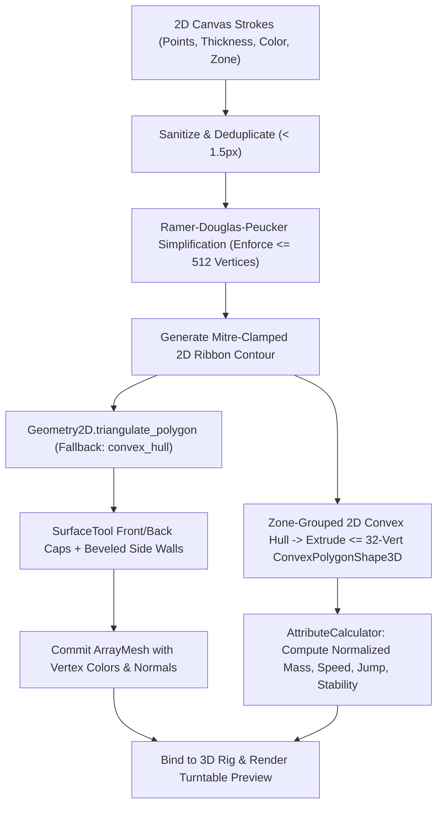

# Draw for Fight (D4F) — Character & Vehicle Creation Pipeline (`CHARACTER_CREATION.md`)

## 1. System Purpose
The Creation Pipeline (`DrawingCanvas2D`, `PolylineSimplifier`, `MeshExtruder3D`, `CollisionBuilder3D`, `AttributeCalculator`) empowers players to sketch custom 2D stickman characters and multi-zone vehicles on an intuitive 2D canvas and immediately converts those 2D strokes into articulated, vertex-colored 3D meshes with compound convex collision shapes and competitively normalized physics attributes.

---

## 2. Functional Requirements
- **FR-CREATE-01**: Provide a $1024 \times 1024$ logical 2D drawing canvas with color palette selector, variable brush radius ($4\text{ px}..36\text{ px}$), eraser tool, clear zone/all, symmetry toggle, and 50-step Undo/Redo history.
- **FR-CREATE-02**: Display guided anatomical template zones for **Characters** (`Head`, `Torso`, `LeftArm`, `RightArm`, `LeftLeg`, `RightLeg`, `Weapon`) and structural zones for **Vehicles** (`Chassis`, `FrontLeftWheel`, `FrontRightWheel`, `RearLeftWheel`, `RearRightWheel`, `Bumper`, `CockpitAnchor`).
- **FR-CREATE-03**: Simplify raw pointer polylines via **Ramer-Douglas-Peucker (RDP)** and enforce a strict budget of $\le 512$ vertices per creation.
- **FR-CREATE-04**: Extrude 2D polylines into watertight 3D beveled ribbon meshes using `SurfaceTool` and generate $\le 8$ `ConvexPolygonShape3D` collision hulls ($\le 32$ vertices each).
- **FR-CREATE-05**: Calculate normalized competitive attributes (`Mass`, `MaxSpeed`, `Acceleration`, `JumpImpulse`, `Stability`, `AttackMultiplier`) in real time and render a live 3D turntable preview with procedural animations.
- **FR-CREATE-06**: Provide offline-first `AIAssistantManager` helper tools (Mirror Symmetry, Stroke Smoothing, Auto-Complete Missing Limbs/Wheels, Preset Archetype Stamp) plus Save/Load to `user://creations/`.

---

## 3. Non-Functional Requirements
- **Real-Time Conversion Latency**: Full 2D-to-3D mesh extrusion + convex collision generation + stat calculation must complete in $< 12\text{ ms}$ on a mid-range CPU whenever the player finishes a stroke.
- **Degenerate Geometry Resilience**: Single-pixel clicks, figure-eight self-intersecting scribbles, zero-area lines, or disconnected floating blobs must never crash `SurfaceTool` or `Jolt Physics`.

---

## 4. Inputs and Outputs
- **Inputs**:
  - User pointer events (`InputEventMouseButton`, `InputEventMouseMotion`) on `DrawingCanvas2D`.
  - Brush settings (`color: Color`, `thickness: float`, `zone_id: String`, `mirror_x: bool`).
  - Optional template preset JSON from `res://data/templates/`.
- **Outputs**:
  - `CreationData` Dictionary/Resource serialized to `user://creations/*.json`.
  - Live `Node3D` hierarchy (`PlayableCharacter3D` or `PlayableVehicle3D`) containing `MeshInstance3D` parts and `CollisionShape3D` hulls.
  - Normalized `StatProfile` Dictionary displayed on the UI stat bars.

---

## 5. Components and Responsibilities

### 5.1 Guided Template Zones & Joint Rigging
1. **Stickman Character Rig (`PlayableCharacter3D`)**:
   - The 2D canvas overlays a translucent guide mannequin partitioned into 7 color-coded zones with explicit joint pivot markers (`NeckPivot`, `ShoulderL`, `ShoulderR`, `HipL`, `HipR`, `HandR_WeaponMount`).
   - Each zone is extruded into its own child `MeshInstance3D` parented to the corresponding 3D joint `Node3D`.
   - If a player draws a limb stroke whose start point is $> 18\text{ px}$ away from the joint pivot, `MeshExtruder3D` automatically generates a tapered connector bridge to the pivot so limbs remain visually attached during running and jumping animations.
2. **Multi-Zone Vehicle Rig (`PlayableVehicle3D`)**:
   - Partitioned into `Chassis` (main body), `Wheel Zones` (front/rear axle pairs), `Bumper/Booster` (front/rear attachments), and `Cockpit Seat`.
   - Strokes in the `Wheel Zones` are analyzed for average radius $R_w \in [0.22\text{m}, 0.55\text{m}]$ and extruded as rotatable 3D wheel cylinders mounted to the 4 raycast suspension arms.

### 5.2 Mathematical 2D-to-3D Conversion Algorithm
1. **Stage 1 — Point Sanitization & Deduplication**:
   - Clamp all coordinates to $[0, 1024]^2$, reject `NaN`/`Inf`, and discard consecutive points where $\|\mathbf{p}_i - \mathbf{p}_{i-1}\|_2 < 1.5\text{ px}$.
2. **Stage 2 — Ramer-Douglas-Peucker (RDP) Simplification**:
   - Recursively decimates each polyline with perpendicular distance threshold $\epsilon = 2.0\text{ px}$.
   - If total simplified points across all strokes exceed the budget ($N_{\text{points}} > 128$, which corresponds to $\approx 512$ 3D vertices after front/back bevel extrusion), $\epsilon$ is iteratively scaled by $1.25\times$ until the vertex budget $\le 512$ is satisfied.
3. **Stage 3 — Mitre-Clamped 2D Ribbon Contour Generation**:
   - Given simplified polyline $\mathbf{p}_0, \mathbf{p}_1, \dots, \mathbf{p}_{k-1}$ and brush radius $r = \text{thickness} / 2$:
   - Compute unit segment normals $\mathbf{n}_i = (-\Delta y_i, \Delta x_i) / \|\Delta \mathbf{p}_i\|$.
   - At interior vertices, compute the bisector tangent/normal and clamp the mitre length to $\le 2.0 \cdot r$ to prevent sharp acute angles from shooting spikes across the screen.
   - Construct a closed counter-clockwise 2D polygon contour $\mathcal{P}_{2D}$ around the stroke spine with rounded 4-segment endcaps.
4. **Stage 4 — Ear-Clipping Triangulation & Beveled 3D Extrusion (`SurfaceTool`)**:
   - Scale 2D canvas coordinates ($1024 \times 1024\text{ px}$) into 3D metric space ($1.8\text{m} \times 1.8\text{m}$ for characters, $2.4\text{m} \times 1.6\text{m}$ for vehicles).
   - Triangulate $\mathcal{P}_{2D}$ using `Geometry2D.triangulate_polygon(contour)`. If self-intersection causes triangulation to return empty, fall back to `Geometry2D.convex_hull(contour)`.
   - Emit **Front Cap** at $z = +D/2$ and **Back Cap** (reversed winding) at $z = -D/2$ ($D = 0.24\text{m}$ for character limbs, $D = 0.85\text{m}$ for vehicle chassis).
   - Emit **Chamfered Perimeter Side Walls** connecting the front and back contours with a $0.03\text{m}$ edge bevel darkened by $20\%$ in vertex color to produce a crisp cartoon ink-outline effect without expensive post-processing shaders.
5. **Stage 5 — Convex Hull Collision Decomposition (`CollisionBuilder3D`)**:
   - For each anatomical/structural zone, merge all 2D contours in that zone and compute `Geometry2D.convex_hull()`.
   - Resample the perimeter to at most $16$ vertices in 2D and extrude to $\pm D/2$, yielding a 3D `ConvexPolygonShape3D` with $\le 32$ vertices (up to 8 hulls total per entity).

### 5.3 Competitive Attribute Normalization Formulas (`AttributeCalculator`)
Let $A_{\text{ink}} \in [0.05, 1.0]$ be the ratio of drawn polygon area to the template reference area, and let $H/W$ be the bounding-box aspect ratio:
- **Mass ($M$)**:
  $$M = \text{clamp}\left(M_{\min} + (M_{\max} - M_{\min}) \cdot (A_{\text{ink}})^{0.85},\; 40.0,\; 160.0\right)\text{ kg}$$
- **Max Speed ($V_{\max}$)**:
  $$V_{\max} = V_{\text{base}} \cdot \left(1.30 - 0.55 \cdot A_{\text{ink}}\right)$$
- **Jump Impulse ($J$)**:
  $$J = J_{\text{base}} \cdot \left(1.20 - 0.35 \cdot A_{\text{ink}}\right)$$
- **Stability Rating ($S \in [0.2, 1.0]$)**:
  $$S = \text{clamp}\left(0.55 \cdot A_{\text{ink}} + 0.45 \cdot \frac{W}{W + H},\; 0.20,\; 1.00\right)$$
- **Attack / Ram Multiplier ($P_{\text{atk}} \in [0.75, 1.35]$)**:
  $$P_{\text{atk}} = 0.75 + 0.60 \cdot \text{clamp}\left(0.5 \cdot A_{\text{weapon\_zone}} + 0.5 \cdot A_{\text{ink}},\; 0.0,\; 1.0\right)$$

---

## 6. Internal Workflow (Character, Vehicle & 2D-to-3D Conversion Diagrams)
*(See also [`03_character_creation_pipeline.md`](file:///C:/Personal%20Project/D4F/draw-for-fight/docs/diagrams/03_character_creation_pipeline.md), [`04_vehicle_creation_pipeline.md`](file:///C:/Personal%20Project/D4F/draw-for-fight/docs/diagrams/04_vehicle_creation_pipeline.md), and [`05_2d_to_3d_conversion_pipeline.md`](file:///C:/Personal%20Project/D4F/draw-for-fight/docs/diagrams/05_2d_to_3d_conversion_pipeline.md))*



---

## 7. Data Structures
- **`Stroke2D` Dictionary**:
  ```gdscript
  {
      "zone_id": "torso",              # Anatomical or vehicle zone identifier
      "color": "#FF3B30",              # Hex RGBA color
      "thickness": 14.0,               # Brush diameter in canvas pixels [4.0 .. 36.0]
      "points": [[512.0, 320.0], [512.0, 480.0], [518.0, 610.0]]
  }
  ```

---

## 8. Dependencies
- Godot `Geometry2D`, `SurfaceTool`, `ArrayMesh`, `ConvexPolygonShape3D`, `SubViewport`.
- `AIAssistantManager` for symmetry/smoothing/template assistance.
- `D4FSerializer` for JSON persistence in `user://creations/`.

---

## 9. Error Handling
- **Missing Critical Zone Fallback**: If a player saves a Character without drawing anything in the `Torso` or `Legs` zones (or a Vehicle without a `Chassis` or `Wheels`), `MeshExtruder3D` automatically synthesizes translucent phantom geometry for the missing critical zones so the rig has valid collision bounds and ground contact.
- **Zero-Length Stroke Click**: A single mouse click with 1 point is automatically expanded into an 8-sided regular polygon disc of radius $\text{thickness}/2$ before triangulation.

---

## 10. Security Considerations
- **Untrusted Remote Creation Sanitization**: When a remote peer uploads its `CreationData` JSON to the lobby, the Host strips any precomputed stats, clamps stroke count to $\le 64$, clamps point count per stroke to $\le 128$, forces vertex budget $\le 512$, and regenerates collision shapes locally.

---

## 11. Performance Considerations
- **Incremental Dirty-Zone Re-Extrusion**: While drawing on the canvas, only the specific `zone_id` currently being modified by the active brush stroke is re-extruded in real time; unmodified zones keep their cached `ArrayMesh`.

---

## 12. Testing Strategy
- **Geometry Edge-Case Unit Tests (`tests/test_creation_pipeline.gd`)**:
  - Tests single-dot click extrusion, bow-tie self-intersecting polygon extrusion, 10,000-point scribble decimation down to $\le 512$ vertices, and stat normalization invariance across 10 synthetic creations.
