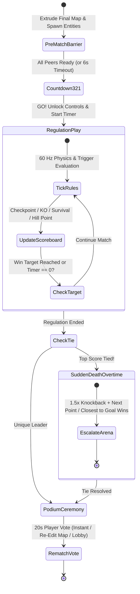

# Draw for Fight (D4F) — Competition Modes Specification (`COMPETITION_MODES.md`)

## 1. System Purpose
The Competition Modes Subsystem (`CompetitionModeBase` and its four concrete implementations: `RaceCompetitionMode`, `ObstacleSurvivalMode`, `PhysicsBattleMode`, and `CustomChallengeMode`) defines the modular rule engines, authoritative scoring formulas, spawn/respawn policies, overtime sudden-death tie-breakers, and post-match rematch workflows that turn player creations and collaborative arenas into structured multiplayer matches.

---

## 2. Functional Requirements
- **FR-MODE-01**: Provide a polymorphic `CompetitionModeBase` base class so `MatchManager` can initialize, tick, query standings, and conclude any competition mode through a unified interface.
- **FR-MODE-02 (`RaceCompetitionMode`)**: Track ordered checkpoint progression (`Checkpoint_0 .. Checkpoint_N -> FinishGoal`), lap counts, split times, and respawn-at-last-checkpoint logic for both character footraces and vehicle rallies.
- **FR-MODE-03 (`ObstacleSurvivalMode`)**: Manage player stock lives ($1..3$), escalating arena hazard speed/frequency, shrinking safe-zone bounds, and survival timestamp ranking.
- **FR-MODE-04 (`PhysicsBattleMode`)**: Attribute knockouts (`last_hit_by_peer_id` within a $5.0\text{s}$ attribution window), award $+2$ points per KO and $-1$ point per self-ringout, and manage $3.0\text{s}$ respawn invulnerability.
- **FR-MODE-05 (`CustomChallengeMode`)**: Allow the Host to customize rule parameters (`gravity_scale`, `knockback_multiplier`, `win_score_target`, `sub_objective` = Coin Rush / King of the Hill / Low-G Brawl, and entity restriction = Character Only / Vehicle Only / Hybrid Switch).
- **FR-MODE-06**: Implement deterministic **Sudden Death Overtime** tie-breaking whenever two or more leaders are tied when the regulation clock reaches `00:00`.

---

## 3. Non-Functional Requirements
- **Zero-Allocation Tick Evaluation**: `CompetitionModeBase._on_physics_tick(delta)` executes at 60 Hz and must evaluate all player standings and trigger checks in $< 0.15\text{ ms}$.
- **Plug-and-Play Extensibility**: Registering a new mode requires only adding a subclass of `CompetitionModeBase` to `MatchManager.MODE_REGISTRY`.

---

## 4. Inputs and Outputs
- **Inputs**:
  - Match configuration dictionary (`mode_id`, `duration_sec`, `target_score`, `custom_mutators`).
  - 60 Hz physics callbacks (`Area3D` checkpoint triggers, blast-zone ring-outs, knockback attribution events).
- **Outputs**:
  - Live `ScoreboardState` dictionary replicated to all peers.
  - `match_concluded(final_rankings, awards)` signal with podium placements (`1st`, `2nd`, `3rd`, plus special awards like `"Most Creative"`, `"Heavy Hitter"`, `"Architect"`).

---

## 5. Components and Responsibilities

### 5.1 Class Hierarchy & Polymorphic Contract (`res://scripts/modes/`)
All modes inherit from `CompetitionModeBase` (`res://scripts/modes/competition_mode_base.gd`):
```gdscript
class_name CompetitionModeBase
extends Node3D

signal standings_updated(scoreboard: Array)
signal sudden_death_started(tied_peer_ids: Array)
signal match_finished(results: Dictionary)

func setup_mode(config: Dictionary, arena: Node3D, entities: Dictionary) -> void
func on_match_start() -> void
func on_physics_tick(delta: float) -> void
func on_entity_ring_out(victim_peer_id: int, attacker_peer_id: int) -> void
func on_checkpoint_reached(peer_id: int, checkpoint_idx: int) -> void
func evaluate_win_condition() -> bool
func resolve_tiebreaker() -> int
```

### 5.2 Detailed Rules per Competition Mode

#### Mode 1: Race Competition (`res://scripts/modes/race_competition_mode.gd`)
- **Objective**: First player to pass through all ordered checkpoints $C_1, C_2, \dots, C_K$ and cross the `FinishGoal` (supports 1–3 Laps).
- **Progress Metric**:
  $$\text{RaceScore}(p) = (\text{lap}_p \cdot 10000) + (\text{checkpoint}_p \cdot 100) - \text{dist\_to\_next\_cp}(p)$$
- **Respawn Rule**: Falling below the blast zone ($Y < -15\text{m}$) or pressing `R` (Unstuck) respawns the player at the transform of their highest cleared checkpoint after a $1.5\text{s}$ penalty.
- **Completion Grace Timer**: Once 1st place crosses the finish line, a $20.0\text{s}$ countdown begins for remaining racers to finish before standings lock.

#### Mode 2: Obstacle Survival (`res://scripts/modes/obstacle_survival_mode.gd`)
- **Objective**: Outlast all opponents on a hazard-filled arena (rotating sweeper arms, spring traps, crumbling tiles, and player shoves).
- **Escalation Curve**: Every $20\text{ seconds}$, hazard rotation/movement speed increases by $+18\%$ and outer perimeter warning tiles drop away.
- **Scoring & Elimination**: Players start with $N_{\text{stocks}} = 3$ lives. Losing all stocks transitions the player to orbital spectator camera; ranking is determined by `(stocks_remaining, elimination_timestamp_ms)`.

#### Mode 3: Physics Battle (`res://scripts/modes/physics_battle_mode.gd`)
- **Objective**: High-impact brawler / demolition derby. Knock opponents off the arena platform.
- **Last-Hit Attribution Window**: Every physical collision or melee strike sets `victim.last_hit_by_peer_id = attacker_id` and resets `victim.last_hit_timer = 5.0s`.
- **Scoring Formula**:
  - **Knockout (Ring-Out with valid `last_hit_by_peer_id`)**: Attacker gains $+2\text{ pts}$ (`kills += 1`), Victim loses $0\text{ pts}$ (`deaths += 1`).
  - **Self-Ringout (`last_hit_timer <= 0`)**: Victim loses $-1\text{ pt}$ (clamped at $\ge 0$ or signed per room config).
  - **First to Target Score** ($10\text{ pts}$ default) or highest score at `00:00` wins.

#### Mode 4: Custom Challenge (`res://scripts/modes/custom_challenge_mode.gd`)
- **Objective**: Host-tailored sandbox rules combining custom physics mutators (`gravity_scale` $\in [0.35, 2.0]$, `knockback_scale` $\in [0.5, 2.5]$, `speed_scale` $\in [0.7, 1.8]$) with selectable sub-modes:
  - *King of the Hill*: $+1\text{ pt/sec}$ while occupying the moving golden capture zone.
  - *Coin Rush*: Collect spawning 3D sketch-coins across the collaborative map.

---

## 6. Internal Workflow (Competition Match Lifecycle Diagram)
*(See also [`docs/diagrams/10_competition_match_lifecycle.md`](file:///C:/Personal%20Project/D4F/draw-for-fight/docs/diagrams/10_competition_match_lifecycle.md))*



---

## 7. Data Structures
- **`PlayerMatchStanding` Dictionary**:
  ```gdscript
  {
      "peer_id": 2,
      "nickname": "SketchKnight",
      "primary_score": 14,          # Points / Checkpoints / Stocks
      "secondary_metric": 82.45,    # Completion time (s) / Survival time (s) / KOs
      "kills": 7,
      "deaths": 2,
      "rank": 1,
      "is_eliminated": false
  }
  ```

---

## 8. Dependencies
- `MatchManager` (hosts the active `CompetitionModeBase` instance).
- `PlayableCharacter3D` & `PlayableVehicle3D` (emit impact and blast-zone signals).
- `CollaborativeArena3D` (provides spawn transforms, checkpoints, and hazard controllers).

---

## 9. Error Handling
- **Simultaneous Ring-Out Tie-Breaker**: If the last two surviving players in `ObstacleSurvivalMode` fall below the blast zone on the exact same 60 Hz physics tick, the winner is determined by comparing vertical downward velocity ($v_y$) and height above the blast plane at the start of that tick so a deterministic 1st place is always crowned.

---

## 10. Security Considerations
- **Authoritative Scorekeeper**: Clients never send "I scored a point" or "I touched Checkpoint 3" packets. Only the Host's `Area3D` overlap detection and blast-zone height checks mutate `PlayerMatchStanding`.

---

## 11. Performance Considerations
- **Event-Driven UI Broadcasts**: `standings_updated` is only broadcast over the network when a score/checkpoint rank actually changes (plus a periodic 1 Hz sync), avoiding redundant reliable packet traffic on every physics tick.

---

## 12. Testing Strategy
- **Mode Rule Verification (`tests/test_competition_modes.gd`)**:
  - Simulates checkpoint order enforcement in `RaceCompetitionMode` (verifying that skipping `Checkpoint 2` does not credit `Checkpoint 3`).
  - Simulates `PhysicsBattleMode` knockback attribution expiry after $5.0\text{s}$ and verifies Sudden Death overtime activation on tied scores.
