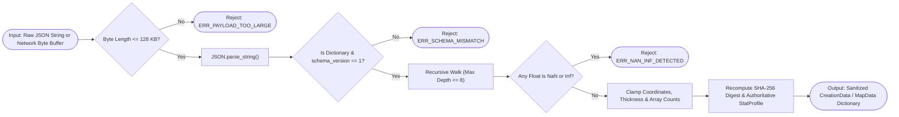

# Draw for Fight (D4F) — Data Design & Serialization (`DATA_DESIGN.md`)

## 1. System Purpose
The Data Design & Serialization Subsystem (`D4FSerializer`, `CreationData`, `MapData`, `SettingsManager`) defines all persistent file formats, network payload schemas, version migration rules, cryptographic checksums, and defensive sanitization guards (`NaN`/`Inf` rejection, nesting depth limits, and string length clamps) across `res://data/` and `user://`.

---

## 2. Functional Requirements
- **FR-DATA-01**: Define strict, versioned JSON schemas (`schema_version = 1`) for custom characters (`type = "character"`), custom vehicles (`type = "vehicle"`), and custom collaborative maps (`type = "map"`).
- **FR-DATA-02**: Persist user creations in `user://creations/`, saved custom maps in `user://maps/`, application settings in `user://settings.cfg`, and cryptographic peer identity in `user://crypto_identity.dat`.
- **FR-DATA-03**: Provide built-in starter templates in `res://data/templates/` and starter arenas in `res://data/maps/` so the game is immediately playable out of the box.
- **FR-DATA-04**: Implement `D4FSerializer.sanitize_and_validate()` to recursively inspect any loaded or network-received JSON/Dictionary and reject `NaN`, `Inf`, negative thickness, oversized arrays, or nesting depth $> 8$.

---

## 3. Non-Functional Requirements
- **Payload Compactness**: A serialized `CreationData` JSON must stay $< 24\text{ KB}$ uncompressed ($< 6\text{ KB}$ when compressed via `FileAccess.COMPRESSION_DEFLATE` for network transfer).
- **Atomic File Writes**: Saving creations or settings writes to a temporary `.tmp` file first and renames to the target filename so a power loss or crash never corrupts existing user saves.

---

## 4. Inputs and Outputs
- **Inputs**: Raw JSON strings from disk (`user://`) or network buffers (`Channel 1`), and in-memory GDScript Dictionaries.
- **Outputs**: Validated, sanitized GDScript Dictionaries, `SHA-256` content digests, and atomic disk files.

---

## 5. Components and Responsibilities

### 5.1 Storage Directory Layout (`user://` vs `res://`)
```text
user:// (OS AppData\Roaming\Godot\app_userdata\Draw for Fight\)
├── settings.cfg                       # Audio, Display, Controls, Player Profile
├── crypto_identity.dat                # Layer 3 Persistent Identity Key & TOFU Known Hosts
├── creations/
│   ├── char_default_hero.json         # User-saved custom stickman characters
│   ├── veh_turbo_sketch.json          # User-saved custom vehicles
│   └── autosave/                      # Emergency autosaves on unexpected disconnect
└── maps/
    └── map_custom_castle.json         # User-saved collaborative 3D maps

res://data/ (Read-Only Bundled Templates)
├── templates/
│   ├── char_brawler_template.json     # Balanced starter character
│   ├── char_speedster_template.json   # Agile lightweight character
│   ├── veh_rally_kart_template.json   # Balanced 4-wheel kart
│   └── veh_heavy_dozer_template.json  # High-mass bumper truck
└── maps/
    ├── arena_skyway_race.json         # Default Race Competition track
    ├── arena_hazard_island.json       # Default Obstacle Survival platform
    ├── arena_knockout_ring.json       # Default Physics Battle stadium
    └── arena_custom_playground.json   # Default Custom Challenge arena
```

### 5.2 `D4FSerializer` Defensive Sanitization Rules (`res://scripts/utils/d4f_serializer.gd`)
Every JSON payload loaded from disk or received from a network peer passes through `D4FSerializer`:
1. **Byte Size Guard**: Reject raw strings $> 131,072\text{ bytes}$ ($128\text{ KB}$).
2. **Recursion Depth Limit**: Reject any Dictionary/Array nested deeper than `MAX_DEPTH = 8`.
3. **Float Sanitization (`is_nan` / `is_inf`)**: Every `TYPE_FLOAT` value is checked with `is_nan(v) or is_inf(v)`. Any non-finite float causes immediate rejection (`ERR_INVALID_DATA`). Floats are clamped to $[-10000.0, +10000.0]$ and rounded to $0.001$ precision.
4. **String Sanitization**: Strip control characters (`ASCII < 32`) and clamp string identifiers/names to $\le 64\text{ characters}$.
5. **Array Length Clamping**:
   - `strokes.size() <= 64`
   - `stroke.points.size() <= 128`
   - `placed_objects.size() <= 64`

---

## 6. Internal Workflow (Serialization & Sanitization Pipeline)


---

## 7. Data Structures (Canonical JSON Schemas)

### 7.1 `CreationData` Schema (`char_*.json` & `veh_*.json`)
```json
{
  "schema_version": 1,
  "creation_id": "c7f92a10-4b8e-4d1a-9c22-81a0f3e59d11",
  "creation_type": "character",
  "name": "Ink Blademaster",
  "author_nickname": "PlayerOne",
  "created_at_unix": 1730448000,
  "canvas_size": [1024, 1024],
  "extrusion_depth_m": 0.24,
  "strokes": [
    {
      "zone_id": "head",
      "color": "#FFD60A",
      "thickness": 16.0,
      "points": [[512.0, 180.0], [540.0, 210.0], [512.0, 240.0], [484.0, 210.0], [512.0, 180.0]]
    },
    {
      "zone_id": "torso",
      "color": "#0A84FF",
      "thickness": 22.0,
      "points": [[512.0, 250.0], [512.0, 480.0]]
    }
  ],
  "computed_stats": {
    "mass_kg": 78.5,
    "max_speed": 10.6,
    "acceleration": 25.2,
    "jump_impulse": 10.1,
    "stability_rating": 0.72,
    "attack_multiplier": 1.04
  },
  "sha256_digest": "e3b0c44298fc1c149afbf4c8996fb92427ae41e4649b934ca495991b7852b855"
}
```

### 7.2 `MapData` Schema (`map_*.json`)
```json
{
  "schema_version": 1,
  "map_id": "arena_custom_01",
  "map_name": "Glacier Bounce Speedway",
  "base_template": "arena_skyway_race",
  "map_revision": 14,
  "spawn_points": [
    [-6.0, 1.0, 20.0], [-2.0, 1.0, 20.0], [2.0, 1.0, 20.0], [6.0, 1.0, 20.0]
  ],
  "checkpoints": [
    {"index": 0, "position": [0.0, 1.5, 0.0], "radius": 5.0},
    {"index": 1, "position": [0.0, 3.0, -25.0], "radius": 5.0}
  ],
  "finish_goal": {"position": [0.0, 4.0, -50.0], "radius": 6.0},
  "terrain_strokes": [
    {
      "item_id": "1_01",
      "owner_peer_id": 1,
      "surface_type": "ice",
      "width_m": 4.0,
      "thickness_m": 0.5,
      "elevation_y": 2.0,
      "points_xz": [[0.0, 10.0], [0.0, -15.0]]
    }
  ],
  "placed_objects": [
    {
      "item_id": "2_01",
      "owner_peer_id": 2,
      "prop_type": "spring_bumper",
      "position": [2.5, 2.5, -10.0],
      "rotation_deg": [0.0, 0.0, 0.0],
      "scale": [1.0, 1.0, 1.0]
    }
  ]
}
```

---

## 8. Dependencies
- Godot `JSON`, `FileAccess`, `DirAccess`, `ConfigFile`, `HashingContext`.

---

## 9. Error Handling
- **Corrupted Local Save Fallback**: If a JSON file in `user://creations/` fails checksum or JSON parsing, `D4FSerializer` logs a non-fatal warning, moves the corrupted file to `user://creations/corrupted_backup/`, and loads the default template from `res://data/templates/` so the game never crashes on startup.

---

## 10. Security Considerations
- **No `ResourceLoader` on Untrusted Files**: D4F **never** loads `.tres` or `.res` Godot binary/text resources from `user://` or network peers, because Godot `.tres` files can embed arbitrary `GDScript` sub-resources (CVE-style arbitrary code execution vector). All user/network data uses strictly parsed JSON validated by `D4FSerializer`.

---

## 11. Performance Considerations
- **Deflate Packet Compression**: Before transmitting `CreationData` or `MapData` over ENet Channel 1, the UTF-8 JSON bytes are compressed with `PackedByteArray.compress(FileAccess.COMPRESSION_DEFLATE)` (with a hard decompressed size cap of $128\text{ KB}$ to prevent zip-bombs).

---

## 12. Testing Strategy
- **Fuzz & Sanitizer Tests (`tests/test_serializer.gd`)**: Feeds deeply nested dictionaries (depth 20), `NAN`, `INF`, negative brush thicknesses, and oversized point arrays into `D4FSerializer` and verifies deterministic rejection/clamping.
