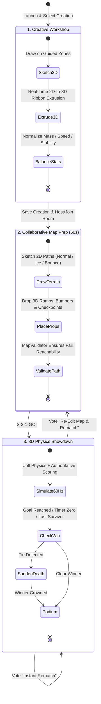

# Draw for Fight (D4F) — Game Design Document (GDD)

## 1. System Purpose
**Draw for Fight (D4F)** is a 3D multiplayer creative-competitive party action game built in **Godot Engine 4.x** (`GL Compatibility` renderer + `Jolt Physics`). Players sketch custom 2D stickman fighters and multi-zone vehicles on an interactive canvas, which are procedurally extruded in real time into rigged, physics-driven 3D entities with balanced competitive attributes. Before each match, up to 8 connected players (and/or offline-capable AI bots) enter a timed **Collaborative 3D Map Editor** to draw terrain splines and place interactive hazards/ramps, then battle across four core competition modes: **Race Competition**, **Obstacle Survival**, **Physics Battle**, and **Custom Challenge**.

---

## 2. Functional Requirements
| ID | Requirement Description | Priority |
| :--- | :--- | :--- |
| **FR-GDD-01** | Provide a guided 2D Stickman Character Creation canvas (`Head`, `Torso`, `Left/Right Arms`, `Left/Right Legs`, `Weapon/Accessory`) that converts strokes into a 3D articulated fighter. | Must Have |
| **FR-GDD-02** | Provide a guided 2D Vehicle Creation canvas (`Chassis`, `Front/Rear Wheels`, `Bumper/Booster`, `Seat Anchor`) that converts strokes into a 3D raycast-suspension vehicle. | Must Have |
| **FR-GDD-03** | Enforce deterministic competitive normalization so total ink area and geometry dimensions trade off `Mass` & `Stability` against `Top Speed` & `Jump Impulse`. | Must Have |
| **FR-GDD-04** | Support self-hosted 2–8 player multiplayer (Listen-Server Host + Joining Clients) over LAN/Direct IP/Relay with zero external dedicated server dependencies. | Must Have |
| **FR-GDD-05** | Feature a timed 60-second **Collaborative Map Preparation** phase where all players draw 2D terrain paths (extruded to 3D) and place 3D props before match start. | Must Have |
| **FR-GDD-06** | Deliver 4 playable Competition Modes (`Race`, `Survival`, `Physics Battle`, `Custom Challenge`) with authoritative scoring, tie-breakers, and instant rematch voting. | Must Have |
| **FR-GDD-07** | Include an offline-capable `AIAssistantManager` providing optional stroke symmetry/silhouette suggestions during creation and AI bot opponents in single/multiplayer matches. | Must Have |

---

## 3. Non-Functional Requirements
- **Accessibility & Low-Spec Hardware Compatibility**: Must run at a locked **60 FPS** at 1080p on low-to-mid-range Windows 10/11 x64 PCs (Intel UHD 620 / AMD Vega 8 integrated GPUs or GTX 1050 discrete GPUs, 8 GB RAM) using the `gl_compatibility` renderer.
- **Pick-Up-And-Play Onboarding**: A brand-new player must be able to draw a valid character or vehicle in under **30 seconds**, aided by ghost templates and one-click preset stamps.
- **Fairness Invariant**: Every custom creation's normalized total stat budget must sum to a constant competitive index ($C_{\text{budget}} = 400 \pm 5$ points across Mass, Speed, Agility, and Stability).

---

## 4. Inputs and Outputs
- **Inputs**:
  - Player mouse/tablet pointer strokes ($X, Y$, brush thickness, color, zone classification).
  - Keyboard/Mouse gameplay controls (`WASD` movement, `Space` jump/handbrake, `LMB` primary strike/boost, `RMB` grab/secondary dash, `Shift` sprint/drift).
  - Match configuration parameters (Mode selection, time limit, score target, bot count, map prep duration).
- **Outputs**:
  - Procedurally extruded 3D `ArrayMesh` models with vertex-colored cartoon shaders and compound `ConvexPolygonShape3D` colliders.
  - Real-time 60 Hz 3D physics simulation telemetry, visual knockback bursts, procedural audio SFX triggers, and authoritative match standings.

---

## 5. Components and Responsibilities

### 5.1 Core Game Loop & Creative-Competitive Balance
D4F bridges unconstrained player creativity with tight competitive balance through three interlocked phases:
1. **Workshop Phase (Solo or Pre-Lobby)**: Players sketch their avatar and vehicle. The `AttributeCalculator` inspects the 2D polygon area, bounding box aspect ratio, and center-of-mass distribution to compute 4 transparent core stats displayed on a live radar/bar chart:
   - **Weight / Mass ($M \in [40, 160]\text{ kg}$)**: Increases momentum and knockback resistance; reduces acceleration and jump height.
   - **Top Speed ($V_{\max} \in [6.5, 13.5]\text{ m/s}$ for characters, $[14.0, 28.0]\text{ m/s}$ for vehicles)**: Inversely proportional to normalized ink area.
   - **Agility / Jump & Turn Rate ($A \in [0.6, 1.4]\times$ base)**: Higher for compact, low-moment-of-inertia designs.
   - **Impact Power ($P \in [0.75, 1.35]\times$ base)**: Scales with weapon/bumper zone density and forward velocity at impact.
2. **Collaborative Arena Preparation Phase (60s Pre-Match)**: Before the whistle blows, all players view the 3D arena from an interactive top-down/orbital camera. Each player has an Equal Allocation Budget (`100 ink units` for terrain paths + `5 interactive prop placements`) to shape ramps, bridges, ice slicks, or spring bumpers. `MapValidator` continuously verifies that spawns remain clear and that a valid traversable path connects start to finish.
3. **3D Showdown Phase (90s–180s Match)**: Players control their custom creations in high-energy physics competition. Knockbacks, vehicle drifts, hazard activations, and clutch overtime finishes feed into the Podium & Rematch screen.

### 5.2 The Four Competition Modes
| Mode | Objective | Respawn Rule | Primary Scoring Metric | Overtime / Tie-Breaker |
| :--- | :--- | :--- | :--- | :--- |
| **1. Race Competition** | Traverse checkpoint gates from Start Pad to Finish Line (Character Footrace or Vehicle Rally). | Instant respawn at last cleared checkpoint ($1.5\text{s}$ penalty). | Completion time ($ms$) & Checkpoint index. | Sudden-death distance-to-next-checkpoint comparison. |
| **2. Obstacle Survival** | Stay inside the arena while avoiding sweeping beams, crumbling floor tiles, and player shoves. | Elimination (1–3 Stocks configurable) or Spectator mode. | Survival duration ($s$) & Remaining stocks. | Shrinking safe-zone boundary + 1.5x knockback multiplier. |
| **3. Physics Battle** | Ring-out brawler / bumper-car derby. Strike and ram opponents off the floating platform. | Unlimited respawns ($3.0\text{s}$ drop-in invulnerability). | $+2$ pts per Knockout (Last-Hit Attribution), $-1$ pt per Self-Ringout. | Next Ring-Out Wins (Golden Knockout). |
| **4. Custom Challenge** | Host-configured hybrid mode (Collectible Coin Rush, King of the Hill Zone, or Low-Gravity Mayhem). | Configurable ($2.0\text{s}$ respawn). | Objective points (Coins collected / Seconds in Hill / KOs). | First score change breaks tie. |

### 5.3 Visual, Audio & AI Direction
- **Visual Style**: Vibrant "Sketchbook-Come-to-Life" 3D aesthetic. Extruded creations feature thick dark-ink edge bevels, bright flat/toon vertex colors, expressive procedural wobble on movement, and high-contrast arena readability optimized for `gl_compatibility`.
- **Audio Architecture (`AudioManager`)**: Dynamic 3-stem background music (Workshop Chill -> Map Prep Tension -> High-Tempo Match Percussion) paired with pitch-randomized polyphonic SFX pools (marker squeaks on canvas, cartoon boings, heavy physics thuds, crowd cheers).
- **Offline-First AI Integration (`AIAssistantManager`)**:
  - *Creative Assistant*: Offers non-intrusive 1-click actions ("Mirror Symmetry", "Smooth Jagged Strokes", "Auto-Complete Missing Wheel/Limb", "Apply Starter Template") using deterministic geometric heuristics—requiring zero cloud API keys or internet access.
  - *Arena Bots*: Utility-driven 3D AI controllers that navigate waypoints, steer vehicles along A* corridors, dodge sweeping hazards, and target nearby rivals in Physics Battle.

---

## 6. Internal Workflow


---

## 7. Data Structures
- **`StatProfile` Dictionary**:
  ```gdscript
  {
      "mass_kg": 85.0,          # [40.0 .. 160.0]
      "max_speed": 10.2,        # [6.5 .. 13.5] char / [14.0 .. 28.0] vehicle
      "acceleration": 24.0,     # m/s^2
      "jump_impulse": 9.8,      # N*s vertical impulse
      "stability_rating": 0.78, # [0.0 .. 1.0] resistance to ragdoll/tip-over
      "attack_multiplier": 1.08,# [0.75 .. 1.35] knockback dealt
      "ink_coverage_ratio": 0.42# [0.05 .. 1.0] normalized area
  }
  ```

---

## 8. Dependencies
- Godot Engine 4.x Core (`CharacterBody3D`, `VehicleBody3D`, `RigidBody3D`, `SurfaceTool`, `Geometry2D`).
- Jolt Physics 3D (`physics/3d/physics_engine="Jolt Physics"`).
- Autoload Singletons: `GameManager`, `MatchManager`, `AIAssistantManager`, `AudioManager`.

---

## 9. Error Handling
- **Empty or Under-Drawn Canvas**: If a player clicks "Ready" with $<5\%$ required ink coverage in critical zones (e.g., missing torso or missing chassis), the system prompts a friendly banner and offers a 1-click "Fill Default Stickman/Kart" fallback so the player is never blocked from joining a match.
- **Unwinnable Custom Map**: If collaborative edits surround the finish line with impassable walls, `MapValidator` automatically carves a $4.0\text{m}$ clearance corridor or spawns an emergency jump-pad bridge when the 60s timer expires.

---

## 10. Security Considerations
- **Server-Side Stat Recomputation**: Joining clients transmit raw 2D stroke vectors (`CreationData`), never pre-calculated physics stats. The authoritative Host recomputes `StatProfile` from the sanitized strokes to prevent speed-hacking or modified JSON stat injection.

---

## 11. Performance Considerations
- **Polycount & Hull Capping**: Every custom creation is hard-capped at $\le 512$ rendered vertices and $\le 8$ convex collision hulls ($\le 32$ vertices each), ensuring that 8 custom characters + 8 custom vehicles + 40 collaborative map props render in $< 1.5\text{ ms}$ GPU frame time on integrated graphics.

---

## 12. Testing Strategy
- **Balance Verification Suite**: Automated headless tests feed 4 extreme archetypes (Minimal Wireframe Stickman, Max-Ink Giant Block, Ultra-Wide Vehicle, Tall Tower Vehicle) into `AttributeCalculator` and assert that all resulting stats remain strictly within competitive bounds and complete a standard 100m test track within a $12\%$ time variance window.
