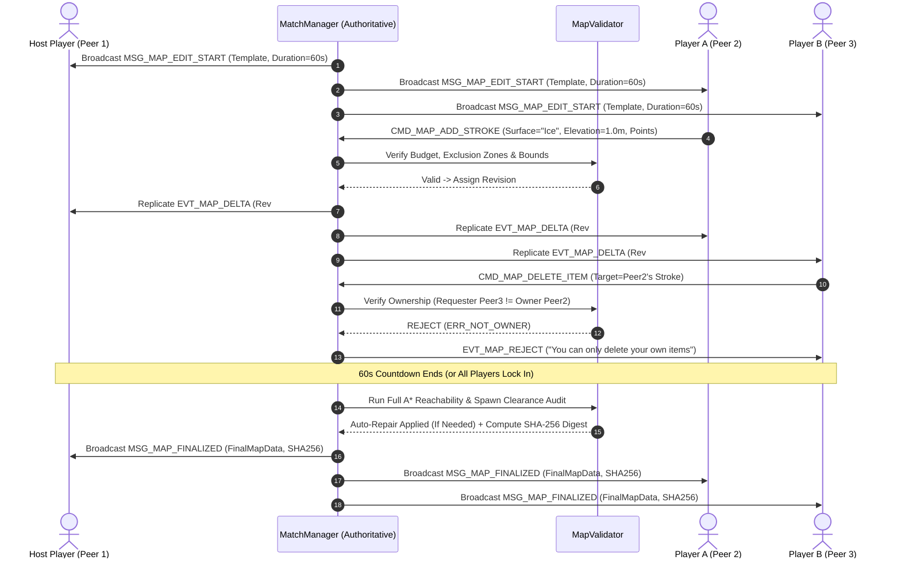

# Draw for Fight (D4F) — Collaborative 3D Map Editor (`MAP_EDITOR.md`)

## 1. System Purpose
The Collaborative Map Editor (`CollaborativeArena3D`, `MapEditorUI`, `MapValidator`) provides a synchronized, multi-user pre-match creative phase (default 60-second countdown) where all connected players simultaneously sketch 2D top-down/elevated terrain ribbons (extruded into 3D walkable platforms with custom surface properties) and place interactive 3D props/hazards while `MapValidator` enforces ownership rules, per-player resource budgets, spawn/goal exclusion zones, and A* path reachability.

---

## 2. Functional Requirements
- **FR-MAP-01**: Support simultaneous real-time editing by up to 8 connected players over a shared base arena template (`Race Track`, `Survival Island`, `Battle Ring`, `Sandbox Grid`).
- **FR-MAP-02**: Provide two complementary editing modes:
  1. **2D Terrain Path Drawing**: Sketch freehand 2D splines with selectable surface material (`Normal`, `Ice`, `Bounce`, `Boost`) and elevation height ($Y \in [-2.0\text{m}, +8.0\text{m}]$) that immediately extrude into 3D walkable platforms.
  2. **3D Interactive Object Placement**: Drag-and-drop, rotate, and snap 3D props (`Ramp`, `Spring Bumper`, `Rotating Sweeper`, `Crates/Barriers`, `Speed Ring`, `Hazard Spike`).
- **FR-MAP-03**: Enforce strict **Item Ownership & Permission Controls**: every drawn terrain stroke and placed prop is tagged with `owner_peer_id`. Standard players (`ROLE_AUTHENTICATED_PLAYER`) can only move or delete their own items; the Host (`ROLE_HOST`) can moderate any item or toggle room-wide edit permissions.
- **FR-MAP-04**: Enforce a synchronized preparation countdown timer ($60\text{s}$ default, configurable $30\text{s}..120\text{s}$) with an early "Lock In / Ready" fast-forward option when all players finish early.
- **FR-MAP-05**: Run authoritative `MapValidator` verification (`verify_and_repair()`) to prevent griefing (blocking spawns, walling off checkpoints, or creating unwinnable gaps) and broadcast the finalized map snapshot (`SHA-256` verified) before starting the match.
- **FR-MAP-06**: Support local saving and loading of custom arena layouts (`user://maps/*.json`) with monotonic revision versioning (`map_revision`).

---

## 3. Non-Functional Requirements
- **Delta Replication Latency**: A terrain stroke or prop placement submitted by any player must appear on all other peers' 3D viewports within $\le 1\text{ RTT} + 20\text{ ms}$.
- **Deterministic Convergence**: All connected peers must converge on the exact same 3D collision geometry (`map_sha256` match) at the end of the preparation phase.

---

## 4. Inputs and Outputs
- **Inputs**:
  - Base map template JSON (`res://data/maps/*.json`).
  - Player editor actions (`CMD_MAP_ADD_STROKE`, `CMD_MAP_PLACE_OBJECT`, `CMD_MAP_DELETE_ITEM`, `CMD_MAP_LOCK_IN`).
- **Outputs**:
  - Replicated `EVT_MAP_DELTA` packets with monotonic `revision_id`.
  - Validated `MapData` Dictionary containing extruded `StaticBody3D` terrain meshes, instantiated 3D prop nodes, and `SHA-256` integrity digest.

---

## 5. Components and Responsibilities

### 5.1 Editor Components (`res://scripts/map_editor/`)
1. **`CollaborativeArena3D` (`res://scripts/map_editor/collaborative_arena_3d.gd`)**:
   - Maintains the authoritative `_strokes: Dictionary` and `_placed_objects: Dictionary` keyed by deterministic `item_uuid` (`"%d_%d" % [owner_peer_id, local_seq]`).
   - Renders color-coded ownership outlines around items during the editing phase so players can clearly see who placed each ramp or hazard.
2. **`MapValidator` (`res://scripts/map_editor/map_validator.gd`)**:
   - **Per-Player Budget Enforcement**:
     - Maximum **15 Terrain Strokes** (or `100.0m` total extruded path length) per player.
     - Maximum **6 Placed 3D Props** per player (up to 48 dynamic props across an 8-player room).
   - **Exclusion Zone Guard**:
     - Rejects any terrain wall or hazard prop placed within a $3.5\text{m}$ radius sphere around any `SpawnPoint` or `Checkpoint`/`Goal` trigger so players cannot spawn-trap opponents.
   - **A* Reachability & Anti-Griefing Auto-Repair**:
     - Discretizes the arena into a 3D traversability graph ($1.0\text{m}$ XZ resolution, supporting step-up $\Delta Y \le 2.2\text{m}$ and jump gap $\Delta XZ \le 5.5\text{m}$).
     - Runs A* pathfinding from every `SpawnPoint` to `Checkpoint_1` $\rightarrow \dots \rightarrow$ `FinishGoal`.
     - If a player-placed wall or hazard blocks the last valid path, `MapValidator` iteratively removes the newest blocking item (or synthesizes an indestructible `Auto-Bridge` ramp across a gap) until reachability is restored.

---

## 6. Internal Workflow (Collaborative Map Editing Sequence)
*(See also [`docs/diagrams/06_collaborative_map_editing_workflow.md`](file:///C:/Personal%20Project/D4F/draw-for-fight/docs/diagrams/06_collaborative_map_editing_workflow.md))*



---

## 7. Data Structures
- **`MapTerrainStroke` Dictionary**:
  ```gdscript
  {
      "item_id": "2_14",
      "owner_peer_id": 2,
      "surface_type": "bounce",     # "normal" | "ice" | "bounce" | "boost"
      "width_m": 3.0,               # [1.5 .. 6.0] meters
      "thickness_m": 0.5,           # Vertical slab thickness
      "elevation_y": 1.5,           # [-2.0 .. 8.0] meters
      "points_xz": [[-10.0, 0.0], [-4.0, 0.0], [2.0, 2.5]]
  }
  ```
- **`MapPlacedObject` Dictionary**:
  ```gdscript
  {
      "item_id": "3_04",
      "owner_peer_id": 3,
      "prop_type": "spring_bumper", # "ramp" | "spring_bumper" | "sweeper" | "crate" | "speed_ring"
      "position": [4.5, 0.5, -8.0],
      "rotation_deg": [0.0, 45.0, 0.0],
      "scale": [1.0, 1.0, 1.0]
  }
  ```

---

## 8. Dependencies
- `MeshExtruder3D` (reused to extrude 2D terrain splines into 3D platform slabs).
- `MatchManager` & `NetworkManager` (Channel 1 reliable ordered delta replication).
- `D4FSerializer` (saving/loading `user://maps/*.json`).

---

## 9. Error Handling
- **Revision Out-of-Sync Recovery**: Every `EVT_MAP_DELTA` carries `revision_id`. If a client detects a gap (`incoming_rev > local_rev + 1`) or if its computed `SHA-256` digest at countdown end differs from `MSG_MAP_FINALIZED.map_sha256`, the client automatically applies the full authoritative `FinalMapData` payload included in `MSG_MAP_FINALIZED`.

---

## 10. Security Considerations
- **Server-Side Ownership Enforcement**: Clients cannot spoof `owner_peer_id` in `CMD_MAP_ADD_STROKE` or `CMD_MAP_DELETE_ITEM`; the Host overwrites `owner_peer_id` with the authenticated `sender_peer_id` from `SecurityManager` Layer 8.

---

## 11. Performance Considerations
- **Batched Static Collider Rebaking**: During interactive drawing, preview ribbons render via lightweight `ImmediateMesh` / `ArrayMesh` instances; full Jolt `ConcavePolygonShape3D` / compound `ConvexPolygonShape3D` static bodies are committed once per completed stroke.

---

## 12. Testing Strategy
- **Anti-Griefing & Ownership Tests (`tests/test_map_editor.gd`)**:
  - Verifies that Peer 3 is blocked from deleting Peer 2's prop, while Host (Peer 1) can delete any prop.
  - Places a solid wall ring around the finish goal and verifies that `MapValidator.verify_and_repair()` detects the blocked A* path and removes the offending wall before match start.
