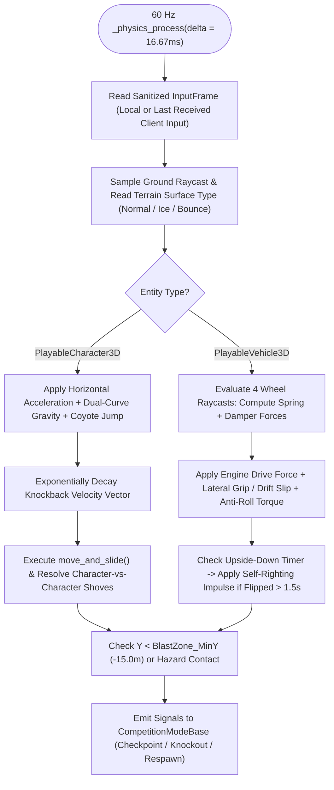

# Draw for Fight (D4F) — 3D Physics & Vehicle Dynamics (`PHYSICS.md`)

## 1. System Purpose
The Physics Subsystem integrates **Jolt Physics 3D** (`physics/3d/physics_engine="Jolt Physics"`) at a deterministic 60 Hz simulation rate to drive expressive, arcade-responsive movement, knockback combat, raycast vehicle suspension, and interactive arena hazards (`Ice`, `Bounce`, `Conveyor`, `Rotating Sweeper`, `Spring Bumper`) for both `PlayableCharacter3D` and `PlayableVehicle3D`.

---

## 2. Functional Requirements
- **FR-PHYS-01**: Simulate 3D character locomotion (`PlayableCharacter3D`) with responsive acceleration, coyote-time jumping ($120\text{ ms}$), air control, melee/dash strike impulses, and stability-scaled knockback recovery.
- **FR-PHYS-02**: Simulate 3D custom vehicle dynamics (`PlayableVehicle3D`) using a 4-point raycast suspension model, longitudinal acceleration/braking, pacejka-lite lateral tire friction with drift slip, and automatic anti-roll stabilization.
- **FR-PHYS-03**: Enforce the mass-vs-speed competitive trade-off calculated by `AttributeCalculator` so heavy creations resist knockback and deal strong ramming momentum while light creations accelerate faster and jump higher.
- **FR-PHYS-04**: Support distinct surface material physics modifiers (`Normal`, `Ice/Low-Friction`, `Bounce/Restitution`, `Boost Pad`, `Hazard Ring-Out`).
- **FR-PHYS-05**: Define a clean 8-layer collision matrix preventing self-collision between a character's own articulated limbs while enabling accurate player-vs-player and player-vs-hazard impacts.

---

## 3. Non-Functional Requirements
- **Physics Step Budget**: A full 60 Hz physics tick with 8 active custom characters/vehicles and 40 dynamic/kinematic arena props must execute in $< 1.8\text{ ms}$ on a 4-core CPU using Jolt Physics.
- **Anti-Tunneling**: Fast-moving vehicles ($V_{\max} \le 28\text{ m/s}$) and knockback launches use Continuous Collision Detection (CCD) / safety raycast sweeps so entities never clip through thin custom-extruded terrain walls.

---

## 4. Inputs and Outputs
- **Inputs**:
  - Normalized `StatProfile` (`mass_kg`, `max_speed`, `acceleration`, `jump_impulse`, `stability_rating`, `attack_multiplier`).
  - Compound `ConvexPolygonShape3D` hulls from `CollisionBuilder3D`.
  - 60 Hz sanitized player/bot control vectors (`move_dir`, `jump_pressed`, `attack_pressed`, `drift_pressed`).
- **Outputs**:
  - Updated 3D world transforms (`global_transform`), linear/angular velocities, grounded flags, and collision impact events (`entity_hit_by_impulse`, `hazard_triggered`, `ring_out_detected`).

---

## 5. Components and Responsibilities

### 5.1 Character Physics Model (`PlayableCharacter3D`)
`PlayableCharacter3D` uses a hybrid **Kinematic-Impulse Character Controller** built on `CharacterBody3D`:
- **Horizontal Velocity Integration**:
  $$\mathbf{v}_{\text{horiz}}(t + \Delta t) = \text{move\_toward}\left(\mathbf{v}_{\text{horiz}}(t),\; \mathbf{d}_{\text{input}} \cdot V_{\max},\; a_{\text{eff}} \cdot \Delta t\right) + \mathbf{v}_{\text{knockback}}(t)$$
  where $a_{\text{eff}}$ is modulated by the underlying terrain surface (`1.0` on Normal, `0.18` on Ice, `1.35` on Boost Pad).
- **Vertical Gravity & Jump**:
  - Uses dual-gravity curve for snappy arcade feel: $g_{\text{up}} = 22.0\text{ m/s}^2$ while rising ($v_y > 0$) and $g_{\text{down}} = 34.0\text{ m/s}^2$ while falling ($v_y \le 0$).
  - Supports $120\text{ ms}$ **Coyote Time** (can jump briefly after walking off a ledge) and $100\text{ ms}$ **Jump Input Buffering**.
- **Knockback & Momentum Exchange**:
  When Attacker $A$ strikes or rams Target $B$ with relative closing velocity $\mathbf{v}_{\text{rel}}$:
  $$I_{\text{knockback}} = B_{\text{base\_impulse}} \cdot P_{\text{atk}, A} \cdot \left(\frac{M_A}{M_B}\right)^{0.65} \cdot (1.25 - 0.50 \cdot S_B)$$
  - Target $B$ receives instantaneous velocity impulse $\Delta \mathbf{v}_B = \hat{\mathbf{d}}_{\text{impact}} \cdot I_{\text{knockback}} + \mathbf{u}_y \cdot (0.35 \cdot I_{\text{knockback}})$ and records `last_hit_by_peer_id = A.peer_id` for $5.0\text{ seconds}$ so ring-out KOs are accurately credited.

### 5.2 Raycast Vehicle Physics Model (`PlayableVehicle3D`)
Rather than relying on fragile hinge-joint wheels that can snag on custom-drawn seams, `PlayableVehicle3D` implements a battle-tested **4-Raycast Arcade Suspension & Tire Model**:
1. **Suspension Spring & Damper (Per Wheel $i \in \{FL, FR, RL, RR\}$)**:
   - Each wheel casts a ray downward of length $L_{\max} = L_{\text{rest}} + R_{\text{wheel}}$.
   - Compression $x_i = L_{\text{rest}} - d_{\text{hit}}$, compression rate $\dot{x}_i = (x_i - x_{i,\text{prev}}) / \Delta t$.
   - Upward normal force:
     $$F_{\text{susp}, i} = \max\left(0.0,\; k_{\text{spring}} \cdot x_i + c_{\text{damper}} \cdot \dot{x}_i\right)$$
2. **Center-of-Mass Lowering & Anti-Roll Stabilization**:
   - Regardless of how tall a player sketches their vehicle chassis on the 2D canvas, `PlayableVehicle3D` clamps the physical Center of Mass to $\mathbf{c}_{\text{CoM}} = (0, -0.22\text{m}, 0)$ relative to the axle plane.
   - An **Anti-Roll Bar Torque** is applied every physics tick between left and right wheel pairs:
     $$\tau_{\text{roll}} = k_{\text{arb}} \cdot (x_{\text{left}} - x_{\text{right}})$$
   - If a vehicle nonetheless flips upside down ($\mathbf{n}_{\text{up}} \cdot \mathbf{Y}_{\text{world}} < 0.1$) for $> 1.5\text{ seconds}$, an automatic self-righting recovery torque upright-flips the vehicle so the player is never permanently stranded.
3. **Longitudinal Drive & Lateral Drift Grip**:
   - Forward force $F_{\text{drive}} = \text{throttle} \cdot F_{\text{engine}}(M, V_{\max})$.
   - Lateral slip velocity $v_{\text{lat}} = \mathbf{v}_{\text{wheel}} \cdot \hat{\mathbf{r}}_{\text{right}}$ is countered by lateral tire friction $F_{\text{lat}} = -\mu_{\text{grip}} \cdot m_{\text{wheel}} \cdot v_{\text{lat}} / \Delta t$, where holding `Shift` (Drift) lowers $\mu_{\text{grip}}$ from $0.85$ to $0.32$ while building a mini-turbo boost charge.

### 5.3 3D Collision Layer & Mask Matrix
| Layer Bit | Layer Name | Collides With (Mask) | Description |
| :---: | :--- | :--- | :--- |
| **Bit 1 (`1`)** | `WORLD_TERRAIN` | `1, 2, 3, 4, 5` | Static arena floor, extruded custom terrain paths, walls. |
| **Bit 2 (`2`)** | `PLAYER_CHARACTER` | `1, 2, 3, 4, 5, 6` | `PlayableCharacter3D` compound convex hulls. |
| **Bit 3 (`4`)** | `PLAYER_VEHICLE` | `1, 2, 3, 4, 5, 6` | `PlayableVehicle3D` chassis hulls. |
| **Bit 4 (`8`)** | `ARENA_PROPS_HAZARDS` | `1, 2, 3, 4` | Dynamic bumpers, sweeping beams, boulders, spring pads. |
| **Bit 5 (`16`)** | `PROJECTILES_ATTACKS` | `1, 2, 3, 4` | Melee strike hitboxes and weapon swing volumes. |
| **Bit 6 (`32`)** | `TRIGGERS_CHECKPOINTS` | `2, 3` | Area3D checkpoints, finish line, King-of-the-Hill zones, Ring-Out blastzone. |

---

## 6. Internal Workflow (60 Hz Physics & Knockback Evaluation Flow)


---

## 7. Data Structures
- **`SurfacePhysicsPreset` Dictionary**:
  ```gdscript
  const SURFACE_PRESETS = {
      "normal": {"friction": 1.0,  "accel_mult": 1.0,  "restitution": 0.05, "speed_mult": 1.0},
      "ice":    {"friction": 0.12, "accel_mult": 0.22, "restitution": 0.05, "speed_mult": 1.15},
      "bounce": {"friction": 0.90, "accel_mult": 1.0,  "restitution": 1.35, "speed_mult": 1.0, "min_bounce_vy": 14.0},
      "boost":  {"friction": 1.0,  "accel_mult": 1.8,  "restitution": 0.0,  "speed_mult": 1.45}
  }
  ```

---

## 8. Dependencies
- Godot 4.x `Jolt Physics` 3D engine (`CharacterBody3D`, `RigidBody3D`, `StaticBody3D`, `Area3D`, `RayCast3D`, `PhysicsDirectSpaceState3D`).
- `AttributeCalculator` for entity mass and movement caps.

---

## 9. Error Handling
- **Velocity & Position Clamping Guard**: At the end of every `_physics_process()`, entity linear velocity is hard-clamped to $\|\mathbf{v}\| \le 45.0\text{ m/s}$ and angular velocity to $\|\boldsymbol{\omega}\| \le 20.0\text{ rad/s}$. If any coordinate becomes `NaN` or exceeds $\|\mathbf{p}\| > 2000\text{m}$, the entity is immediately teleported to its last valid checkpoint/spawn with zero velocity.

---

## 10. Security Considerations
- **Server-Authoritative Collisions & Knockouts**: Clients predict local movement and collisions for immediate visual feedback, but **only the Host's Jolt Physics simulation** can trigger `ring_out_detected`, award knockout points, or register checkpoint completions.

---

## 11. Performance Considerations
- **Sleep Thresholds & Broadphase Optimization**: Static extruded terrain segments are merged by surface type into compound `StaticBody3D` nodes, reducing Jolt broadphase body count during collaborative map loads.

---

## 12. Testing Strategy
- **Physics Determinism & Stability Tests (`tests/test_physics_dynamics.gd`)**:
  - Verifies that a heavy character ($150\text{ kg}$) receives $< 55\%$ of the knockback displacement of a featherweight character ($45\text{ kg}$) under identical impulse.
  - Verifies that a tall custom vehicle dropped from $5\text{m}$ with a $35^\circ$ roll angle stabilizes upright via the 4-raycast suspension and anti-roll bar within $1.2\text{ seconds}$.
