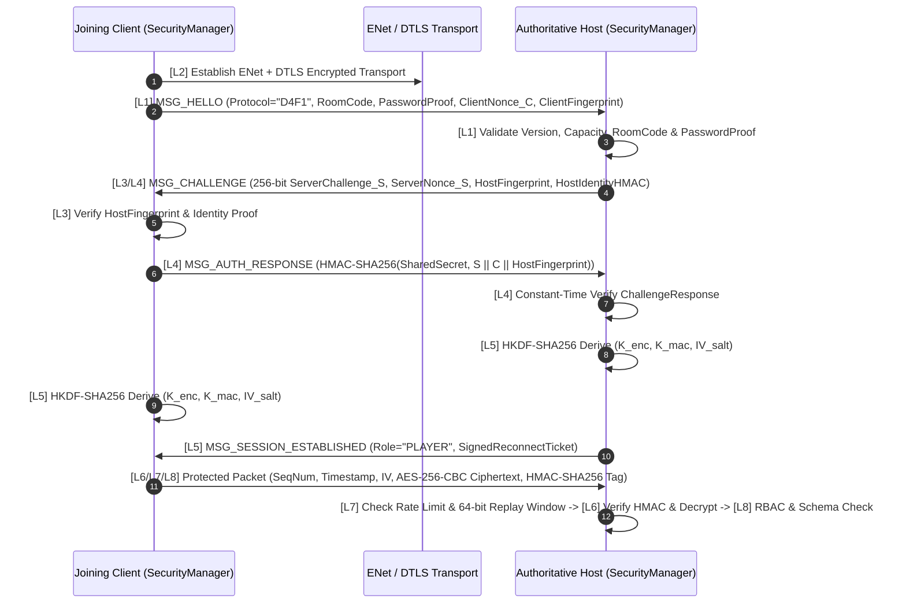

# Draw for Fight (D4F) — Eight-Layer Security Architecture (`SECURITY.md`)

## 1. System Purpose
Because **Draw for Fight (D4F)** relies on a peer-hosted Listen-Server architecture where players exchange custom-drawn geometry (`CreationData`), collaborative map modifications, and high-frequency physics inputs over untrusted networks (LAN, public Wi-Fi, or Relay tunnels), the `SecurityManager` subsystem enforces a defense-in-depth **8-Layer Security Handshake & Runtime Protection Architecture**. Every connection and every packet is cryptographically authenticated, encrypted, replay-protected, rate-limited, and schema-validated.

---

## 2. Functional Requirements
- **FR-SEC-01 (Layer 1 — Lobby Access Control)**: Validate protocol version, room capacity, room code, and salted password proof (`SHA-256` / `PBKDF2-HMAC-SHA256`) before allocating session state.
- **FR-SEC-02 (Layer 2 — Secure Transport Envelope)**: Wrap ENet UDP communication in DTLS 1.2/1.3 (`ENetConnection.dtls_server_setup` / `dtls_client_setup`) with ephemeral self-signed X.509 certificates, paired with application-layer framing.
- **FR-SEC-03 (Layer 3 — Mutual Identity Authentication)**: Generate a persistent 2048-bit RSA / 256-bit Ed25519-equivalent cryptographic identity per installation (`user://crypto_identity.dat`), exchanging public key fingerprints (`SHA-256`) and Trust-On-First-Use (TOFU) host pinning.
- **FR-SEC-04 (Layer 4 — 256-bit Challenge-Response)**: Issue a 32-byte (256-bit) CSPRNG nonce challenge (`Crypto.generate_random_bytes(32)`) requiring mutual `HMAC-SHA256` proof of identity and room secret possession.
- **FR-SEC-05 (Layer 5 — Session Key Establishment via HKDF-SHA256)**: Derive independent per-peer encryption keys ($K_{\text{enc}}$, 32 bytes), MAC keys ($K_{\text{mac}}$, 32 bytes), and IV salts ($S_{\text{iv}}$, 16 bytes) using `HKDF-SHA256` (`RFC 5869`) over ephemeral client/server nonces.
- **FR-SEC-06 (Layer 6 — Authenticated Packet Encryption)**: Encrypt all payloads using `AES-256-CBC` with PKCS#7 padding and authenticate the envelope via **Encrypt-then-MAC (EtM)** using `HMAC-SHA256` verified in constant time.
- **FR-SEC-07 (Layer 7 — Anti-Replay & Rate Limiting)**: Enforce a 64-bit sliding bitmask replay window (`ReplayWindow64`) plus timestamp freshness ($\pm 30\text{s}$ drift window) and per-peer Token-Bucket rate limiters across packet categories.
- **FR-SEC-08 (Layer 8 — RBAC Session Authorization & Deep Payload Sanitization)**: Enforce role-based access control (`HOST`, `AUTHENTICATED_PLAYER`, `SPECTATOR`, `PENDING_AUTH`) and reject any JSON/Variant payload containing `NaN`, `Inf`, excessive nesting depth ($>8$), or out-of-bounds geometry.

---

## 3. Non-Functional Requirements
- **Cryptographic Overhead**: Total per-packet encryption + HMAC verification latency must remain $< 0.08\text{ ms}$ on a single CPU core so an 8-player match at 60 Hz consumes $< 3\%$ CPU time for security processing.
- **Zero Plaintext Leakage**: Sensitive lobby tokens, reconnect tickets, and custom creation transfers are never transmitted in plaintext over the wire.
- **Constant-Time Verification**: All HMAC tag and challenge comparisons use constant-time byte comparison (`constant_time_compare()`) to prevent timing side-channel attacks.

---

## 4. Inputs and Outputs
- **Inputs**:
  - Unverified incoming UDP/ENet byte buffers from remote peers.
  - Outgoing application command dictionaries from `NetworkManager` and `MatchManager`.
  - Room password and local persistent identity keypair from `user://crypto_identity.dat`.
- **Outputs**:
  - Wire-ready encrypted + MAC-tagged `PackedByteArray` frames.
  - Verified, sanitized command dictionaries dispatched to authoritative handlers.
  - Security audit events (`security_violation_detected(peer_id, layer, reason)`) and automatic IP cooldown bans.

---

## 5. Components and Responsibilities

### 5.1 Deep Specification of the 8 Security Layers (`res://scripts/security/`)

| Layer | Name | Cryptographic Primitive / Mechanism | Threat Mitigated |
| :---: | :--- | :--- | :--- |
| **L1** | **Lobby Access Control** | Protocol magic header `"D4F1"`, Room Code check, salted `HMAC-SHA256` password proof, IP ban-list lookup. | Unauthorized room joining, brute-force password guessing, version mismatch crashes. |
| **L2** | **Secure Transport (DTLS)** | `ENetConnection` DTLS wrapper using `Crypto.generate_self_signed_certificate()` + strict packet length framing ($\le 64\text{ KB}$). | Passive network eavesdropping, UDP port scanning, malformed oversized datagram DoS. |
| **L3** | **Mutual Identity Auth** | Persistent Peer Identity Key (`user://crypto_identity.dat`) + `SHA-256` Fingerprint (`AA:BB:CC...`) + Host TOFU pinning. | Rogue Host spoofing (Man-in-the-Middle on LAN beacons) and player identity impersonation. |
| **L4** | **256-Bit Challenge-Response** | 32-byte CSPRNG `ServerChallenge_S` & `ClientNonce_C`; mutual `HMAC-SHA256(SharedAuthSecret, S \|\| C \|\| Fingerprint)`. | Replay of captured login handshakes, unauthenticated socket exhaustion. |
| **L5** | **Session Key Derivation** | **HKDF-SHA256** (`HKDF-Extract` + `HKDF-Expand`) deriving 768 bits of key material: $K_{\text{enc}}$ (256b), $K_{\text{mac}}$ (256b), $S_{\text{iv}}$ (128b). | Key reuse across sessions; compromise of one peer's session key does not expose other peers. |
| **L6** | **Packet Encryption (EtM)** | **AES-256-CBC** (`AESContext.MODE_CBC_ENCRYPT`) + **HMAC-SHA256** (`HashingContext.HASH_SHA256`) in Encrypt-then-MAC order. | Packet tampering, bit-flipping attacks, padding-oracle attacks, payload snooping. |
| **L7** | **Replay & Rate Guard** | Monotonic 64-bit `seq_num` checked against a 64-bit sliding bitmask (`ReplayWindow`) + 3-tier Token Bucket limiter. | Packet replay attacks (e.g., duplicating an attack/score packet) and UDP flood DoS. |
| **L8** | **RBAC & Payload Sanitizer** | Role permission matrix (`HOST` vs `PLAYER`) + `D4FSerializer` recursive bounds/NaN/Inf/vertex-count sanitizer. | Privilege escalation (client sending host-only commands), physics engine NaN poisoning, zip-bomb JSON. |

### 5.2 Wire Format of a Layer-6 Protected Packet
Every post-handshake packet transmitted by `NetworkManager` is wrapped in the following binary/structured envelope before hitting the socket:
```text
+-------------------+-------------------+-------------------+-------------------+
| Magic "D4F1" (4B) | PeerID (4B UInt32)| SeqNum (8B UInt64)| Timestamp (8B ms) |
+-------------------+-------------------+-------------------+-------------------+
| Random IV (16 Bytes generated via Crypto.generate_random_bytes(16))           |
+-------------------------------------------------------------------------------+
| Ciphertext (N Bytes, AES-256-CBC encrypted PKCS#7-padded JSON/Binary Payload) |
+-------------------------------------------------------------------------------+
| HMAC-SHA256 Tag (32 Bytes computed over Magic||PeerID||SeqNum||TS||IV||Cipher)|
+-------------------------------------------------------------------------------+
```

### 5.3 Layer 7 Sliding-Window Replay Protection Algorithm
For each authenticated peer, `SecurityManager` maintains `highest_seq: int` and `window_bitmap: int` (64-bit integer):
1. Let $\Delta = \text{pkt.seq\_num} - \text{highest\_seq}$.
2. If $\Delta > 0$: The packet is newer than any seen so far. Shift `window_bitmap = (window_bitmap << min(delta, 64)) | 1`, set `highest_seq = pkt.seq_num`, and **ACCEPT**.
3. If $\Delta \le 0$ and $|\Delta| < 64$: Check bit `bit_mask = 1 << abs(delta)`.
   - If `(window_bitmap & bit_mask) != 0`: Duplicate packet detected $\rightarrow$ **REJECT (`ERR_REPLAY_DUPLICATE`)**.
   - Else: Set `window_bitmap |= bit_mask` and **ACCEPT** (out-of-order UDP delivery within 64-packet window).
4. If $|\Delta| \ge 64$: Packet is too old $\rightarrow$ **REJECT (`ERR_REPLAY_EXPIRED`)**.

### 5.4 Layer 7 Multi-Tier Token Bucket Rate Limiter
| Bucket Tier | Applicable Traffic | Capacity (Burst) | Refill Rate | Violation Action |
| :--- | :--- | :---: | :---: | :--- |
| **Tier A (High-Freq Input)** | `PKT_CLIENT_INPUT` (Channel 2) | $90\text{ tokens}$ | $65\text{ tokens/s}$ | Drop excess input frames silently. |
| **Tier B (Collaborative Map)** | `CMD_MAP_ADD_STROKE`, `CMD_MAP_PLACE_OBJECT` | $20\text{ tokens}$ | $10\text{ tokens/s}$ | Reject delta with cooldown warning. |
| **Tier C (Heavy Control/Sync)** | `MSG_UPLOAD_CREATION`, Handshake, Rematch Vote | $6\text{ tokens}$ | $1\text{ token/s}$ | Increment strike counter; kick peer at 5 strikes. |

---

## 6. Internal Workflow (Eight-Layer Security Handshake Sequence)
*(See also [`docs/diagrams/09_eight_layer_security_handshake.md`](file:///C:/Personal%20Project/D4F/draw-for-fight/docs/diagrams/09_eight_layer_security_handshake.md))*



---

## 7. Data Structures
- **`PeerSecurityContext` (Maintained per Peer in `SecurityManager`)**:
  ```gdscript
  class_name PeerSecurityContext
  var peer_id: int
  var state: int = AuthState.PENDING_AUTH
  var role: int = Role.NONE
  var identity_fingerprint: String = ""
  var client_nonce: PackedByteArray
  var server_challenge: PackedByteArray
  var key_enc: PackedByteArray          # 32 bytes (AES-256)
  var key_mac: PackedByteArray          # 32 bytes (HMAC-SHA256)
  var iv_salt: PackedByteArray          # 16 bytes
  var tx_seq: int = 0
  var rx_highest_seq: int = 0
  var rx_replay_bitmap: int = 0
  var strike_count: int = 0
  var token_buckets: Dictionary = {}
  ```

---

## 8. Dependencies
- Godot Engine built-in cryptographic classes: `Crypto`, `CryptoKey`, `X509Certificate`, `AESContext`, `HashingContext`, `HMACContext`.
- `D4FSerializer` for Layer 8 deep structural validation.

---

## 9. Error Handling
- **3-Strike Ban Policy**: Any peer that fails Layer 4 Challenge-Response 3 times, triggers 5 Layer 6 HMAC verification failures, or sends a poisoned `NaN`/`Inf` physics packet is immediately disconnected and its IP address is placed in `_temp_ban_list` for $300\text{ seconds}$.
- **Handshake Timeout Sweep**: A 1-second timer in `SecurityManager` sweeps all peers in `AuthState.PENDING_AUTH`; any peer exceeding $5.0\text{ seconds}$ without completing Layer 5 is disconnected to prevent slowloris connection slot starvation.

---

## 10. Security Considerations (Threat Model & Mitigations)
| Threat Scenario | Attack Vector | Mitigating Layer(s) |
| :--- | :--- | :--- |
| **Custom Creation Crash Exploit** | Attacker uploads a `CreationData` JSON with $100,000$ vertices or `NaN` coordinates to crash Jolt Physics on all peers. | **Layer 8**: `D4FSerializer` rejects `NaN`/`Inf` and `PolylineSimplifier` enforces $\le 512$ vertices before mesh generation. |
| **Speed / Knockback Cheating** | Attacker modifies local JSON stats to set `max_speed = 999.0` or sends `move_vector = (50, 50)`. | **Layer 8 + Host Authority**: Host ignores client-supplied stats, recomputes stats from strokes, and clamps `move_vector.length() <= 1.0`. |
| **Collaborative Map Griefing** | Attacker sends `CMD_MAP_DELETE_ITEM` for another player's ramps or floods 1,000 props per second. | **Layer 7 & Layer 8**: Tier-B Token Bucket rate limiter + `MapValidator` ownership check (`item.owner_id == sender_id`). |
| **Packet Sniffing & Replay on Public Wi-Fi** | Attacker captures UDP frames and replays a `CMD_MAP_ADD_STROKE` or `PKT_CLIENT_INPUT` packet. | **Layer 2, 6, & 7**: DTLS + AES-256-CBC EtM encryption + 64-bit sliding window rejects duplicate `seq_num`. |

---

## 11. Performance Considerations
- **Pre-Allocated Contexts**: `AESContext` and `HMACContext` instances are pooled per peer inside `PeerSecurityContext` rather than instantiated on every frame, eliminating GC pressure during 60 Hz packet processing.

---

## 12. Testing Strategy
- **Automated Security Verification Suite (`tests/test_security_suite.gd`)**:
  1. Verifies successful L1–L5 handshake and identical `HKDF-SHA256` session keys on Host and Client.
  2. Verifies wrong room password rejection at L1.
  3. Flips 1 bit of AES-256-CBC ciphertext and asserts L6 EtM `HMAC-SHA256` rejection before decryption.
  4. Re-sends an identical packet (`seq_num = 15`) and asserts L7 `ReplayWindow` rejection.
  5. Sends 150 packets in 10 ms and asserts L7 Token Bucket throttling.
  6. Attempts a `HOST`-only command from a `PLAYER` peer and asserts L8 RBAC rejection.
