# Draw for Fight (D4F) — Detailed System Design (`SYSTEM_DESIGN.md`)

## 1. System Purpose
This document provides the detailed component-level engineering specification for every subsystem in **Draw for Fight (D4F)**, defining explicit method signatures, inputs/outputs, internal algorithms, state invariants, error handling, security boundaries, performance budgets, and verification strategies.

---

## 2. Functional Requirements
- **FR-SYS-01**: Every subsystem must expose strongly typed GDScript APIs and Godot signals for loose coupling.
- **FR-SYS-02**: The 2D-to-3D pipeline must convert arbitrary player strokes into manifold 3D meshes and valid convex collision shapes in $< 15\text{ ms}$ per creation.
- **FR-SYS-03**: The networking and security subsystems must authenticate peers through all 8 security layers and synchronize 60 Hz gameplay across up to 8 peers.
- **FR-SYS-04**: The collaborative map subsystem must enforce per-player resource budgets, object ownership, and A* path reachability.

---

## 3. Non-Functional Requirements
- **Zero Unhandled Exceptions**: All external inputs (JSON files, network packets, user strokes) must be validated by `D4FSerializer` before consumption.
- **Frame-Time Determinism**: No single frame during 3D gameplay may allocate $> 256\text{ KB}$ of heap memory or block the main thread for $> 4.0\text{ ms}$.

---

## 4. Inputs and Outputs
| Subsystem | Primary Inputs | Primary Outputs |
| :--- | :--- | :--- |
| **`DrawingCanvas2D`** | Mouse motion/button events, active `ZoneID`, brush color & thickness | Array of `Stroke2D` dictionaries + undo/redo command stack |
| **`MeshExtruder3D`** | Simplified `PackedVector2Array` polylines, extrusion depth $Z$, bevel width | Godot `ArrayMesh` with normals, tangents, and vertex colors |
| **`CollisionBuilder3D`** | Simplified 2D polylines grouped by zone | Array of `ConvexPolygonShape3D` ($\le 8$ shapes, $\le 32$ verts/shape) |
| **`AttributeCalculator`** | 2D ink area, bounding box, convex hull volume, center of mass | Normalized `StatProfile` (`mass`, `max_speed`, `jump_impulse`, `stability`, `attack`) |
| **`SecurityManager`** | Raw peer packets, room password, peer cryptographic identity | Verified plaintext payload Dictionary or security rejection signal |
| **`NetworkManager`** | Local gameplay commands, room config, LAN UDP beacons | Replicated `WorldSnapshot` frames, peer connection/reconnection events |
| **`MapValidator`** | `MapData` (terrain strokes, 3D props, spawns, goals) | Validation report (`is_valid`, `repaired_map_data`, `reachability_score`) |
| **`CompetitionModeBase`** | 60 Hz physics tick, entity transforms, collision signals | Live leaderboard Dictionary, round state transitions, winner announcement |

---

## 5. Components and Responsibilities

### 5.1 Creation Subsystem (`res://scripts/creation/`)
1. **`DrawingCanvas2D`**:
   - Manages layered 2D drawing across anatomical/structural zones.
   - Implements a bounded 50-step Undo/Redo ring buffer (`_undo_stack`, `_redo_stack`).
   - Clips strokes to active template zone polygons using `Geometry2D.intersect_polyline_with_polygon()`.
2. **`PolylineSimplifier`**:
   - Implements iterative **Ramer-Douglas-Peucker (RDP)** simplification ($\epsilon = 2.0\text{ px}$) and radial distance deduplication ($d_{\min} = 1.5\text{ px}$).
   - Enforces the hard vertex budget ($\le 512$ vertices across all strokes in a creation) by dynamically increasing $\epsilon$ if a player draws excessive detail.
3. **`MeshExtruder3D`**:
   - Converts each simplified 2D polyline of thickness $w$ into a closed 2D ribbon polygon with mitre-clamped corners ($\text{mitre\_limit} = 2.0 \cdot w$).
   - Triangulates the 2D contour via `Geometry2D.triangulate_polygon()` (with `Geometry2D.convex_hull()` fallback for self-intersecting loops) and extrudes front/back caps ($\pm Z/2$) plus chamfered 3D side bevels using `SurfaceTool`.
4. **`CollisionBuilder3D`**:
   - Generates per-zone 2D convex hulls, decimates each hull to $\le 16$ perimeter points, and extrudes them into 3D `ConvexPolygonShape3D` resources compatible with Jolt Physics.
5. **`AttributeCalculator`**:
   - Computes deterministic gameplay stats from geometry metrics so visual form directly governs physical behavior without breaking competitive fairness.

### 5.2 Gameplay & Physics Subsystem (`res://scripts/gameplay/`)
1. **`PlayableCharacter3D`**:
   - Extends `CharacterBody3D` (with dynamic impulse accumulator for knockback integration in Jolt Physics).
   - Procedurally animates stickman limb pivots (`LeftArm`, `RightArm`, `LeftLeg`, `RightLeg`, `Head`, `Weapon`) using damped harmonic oscillators driven by velocity and attack state.
2. **`PlayableVehicle3D`**:
   - Uses a custom 4-raycast suspension controller (`RayCast3D` per wheel mount) applying Hooke's law spring force + velocity damping:
     $$F_{\text{susp}} = k_s \cdot (L_{\text{rest}} - L_{\text{current}}) - c_d \cdot v_{\text{vertical}}$$
   - Applies longitudinal traction, lateral pacejka-lite grip curve, and anti-roll bar stabilizing torque.

### 5.3 Collaborative Map & Mode Subsystem (`res://scripts/map_editor/` & `res://scripts/modes/`)
1. **`CollaborativeArena3D`**:
   - Applies incoming `EVT_MAP_DELTA` commands in real time, extruding 2D terrain strokes into 3D walkable platforms (`Normal`, `Ice`, `Bounce`, `Lava/Hazard`) and instantiating 3D obstacle props.
2. **`MapValidator`**:
   - Builds a 3D coarse navigation grid ($1.0\text{m}$ cell resolution) over the arena and executes **A\* Search** from every `SpawnPoint` to every `Checkpoint`/`FinishGoal`, accounting for maximum player jump height and gap jump distance.
3. **`CompetitionModeBase`**:
   - Abstract base class providing lifecycle hooks: `_on_mode_init()`, `_on_match_start()`, `_on_physics_tick(delta)`, `_on_player_eliminated(peer_id)`, `_check_win_condition()`, and `_resolve_tiebreaker()`.

---

## 6. Internal Workflow (Component Interaction Diagram)

```mermaid
flowchart LR
    subgraph Client_Side["Client Input & Creation"]
        UI["UI Screen / Canvas"]
        SerC["D4FSerializer (Sanitize)"]
        SecC["SecurityManager (Client EtM)"]
    end

    subgraph Host_Authority["Authoritative Host Subsystem Pipeline"]
        SecH["SecurityManager (L1-L8 Verify)"]
        MatchH["MatchManager (State Router)"]
        ValH["AttributeCalculator & MapValidator"]
        PhysH["Jolt Physics 3D + CompetitionModeBase"]
    end

    UI -->|"User Action / Stroke"| SerC
    SerC -->|"Validated Dict"| SecC
    SecC -->|"AES-256-CBC + HMAC Packet"| SecH
    SecH -->|"Authenticated Command"| MatchH
    MatchH -->|"Verify Geometry & Rules"| ValH
    ValH -->|"Spawn / Apply Force"| PhysH
    PhysH -->|"20 Hz WorldSnapshot"| SecH
```


---

## 7. Data Structures
- **`NetworkCommandEnvelope`**:
  ```gdscript
  {
      "cmd_id": int,          # Enum CommandType
      "sender_peer_id": int,  # ENet Peer ID
      "seq_num": int,         # 64-bit monotonic packet sequence number
      "timestamp_ms": int,    # OS ticks msec
      "payload": Dictionary   # Sanitized command parameters
  }
  ```

---

## 8. Dependencies
- Internal dependencies strictly follow a Directed Acyclic Graph (DAG):
  `UI Screens` $\rightarrow$ `GameManager` $\rightarrow$ `MatchManager` $\rightarrow$ `CompetitionModeBase` / `MapValidator` $\rightarrow$ `NetworkManager` $\rightarrow$ `SecurityManager` $\rightarrow$ `D4FSerializer`.

---

## 9. Error Handling
| Failure Mode | Detection Mechanism | Recovery Action |
| :--- | :--- | :--- |
| **Self-Intersecting 2D Stroke** | `Geometry2D.triangulate_polygon()` returns empty `PackedInt32Array` | Automatically fall back to `Geometry2D.convex_hull()` contour triangulation; log debug notice. |
| **Malformed / NaN JSON Payload** | `D4FSerializer.validate_and_sanitize()` detects `is_nan()` or depth $> 8$ | Reject payload immediately; increment peer suspicion counter in `SecurityManager`. |
| **Blocked Arena Goal** | `MapValidator.verify_reachability()` A* returns empty path | Auto-remove the newest offending obstacle prop or insert a fallback bridge ramp between disconnected islands. |
| **Peer Desync / High Packet Loss** | Snapshot delta sequence gap $> 20$ frames | Force full uncompressed keyframe state synchronization for affected peer. |

---

## 10. Security Considerations
- **Capability-Based Command Dispatch**: Every RPC/network command is mapped in `SecurityManager.COMMAND_RBAC_TABLE` to required roles (`ROLE_HOST`, `ROLE_AUTHENTICATED_PLAYER`, `ROLE_SPECTATOR`). Unauthenticated peers (`ROLE_PENDING_AUTH`) can only send `MSG_HELLO` and `MSG_AUTH_RESPONSE`.

---

## 11. Performance Considerations
- **Mesh Caching by SHA-256 Digest**: When a custom character or vehicle `CreationData` JSON is received over the network, its SHA-256 digest is computed. If the mesh is already cached in `MatchManager._mesh_cache`, `MeshExtruder3D` skips regeneration and reuses the existing `ArrayMesh` and `ConvexPolygonShape3D` instances.

---

## 12. Testing Strategy
- **Unit & Integration Tests**:
  - `tests/test_creation_pipeline.gd`: Verifies RDP simplification, self-intersection fallback, vertex cap ($\le 512$), and stat normalization invariants.
  - `tests/test_security_handshake.gd`: Simulates full 8-layer handshake, tampered HMAC rejection, replay attack rejection, and rate-limit throttling.
  - `tests/test_map_validator.gd`: Tests A* reachability detection and automatic griefing repair.
