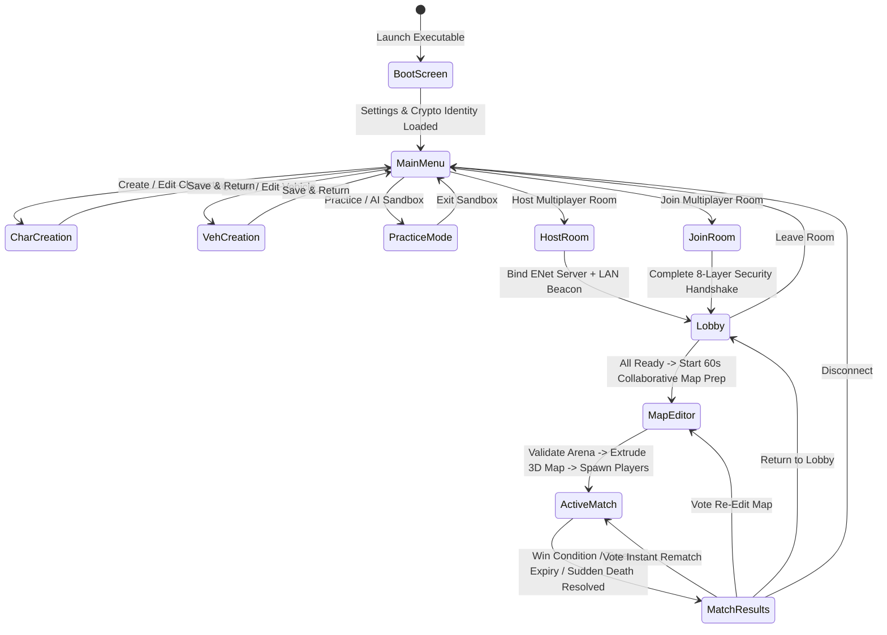

# Draw for Fight (D4F) — End-to-End System Flow (`SYSTEM_FLOW.md`)

## 1. System Purpose
This document traces the complete runtime execution flows across all 11 application screens, detailing state transitions, signal emissions, collaborative map synchronization, and frame-by-frame packet flows from executable launch to match conclusion.

---

## 2. Functional Requirements
- **FR-FLOW-01**: Deterministic navigation across all 11 screens with explicit back-navigation and state cleanup.
- **FR-FLOW-02**: Barrier synchronization before match start ensuring no player's countdown begins until all connected peers have extruded the finalized 3D arena and spawned all player entities.
- **FR-FLOW-03**: Seamless post-match loop allowing players to vote for an **Instant Rematch** (same map), **Re-Edit Map Rematch** (return to 60s collaborative editor), or **Return to Lobby** without reconnecting sockets.

---

## 3. Non-Functional Requirements
- **Screen Transition Latency**: Switching between UI screens must take $< 100\text{ ms}$; extruding the full 3D arena and transitioning from Collaborative Map Editor to Active Match must take $< 500\text{ ms}$.
- **Zero Orphaned Nodes**: Leaving a multiplayer session at any phase must cleanly close ENet sockets, clear entity caches, and restore the Main Menu state.

---

## 4. Inputs and Outputs
- **Inputs**: UI button signals, countdown timers (`MapPrepTimer`, `CountdownTimer`, `MatchTimer`, `RematchVoteTimer`), and network state packets.
- **Outputs**: Screen transitions in `GameManager`, authoritative phase changes in `MatchManager`, and synchronized HUD telemetry across all peers.

---

## 5. Components and Responsibilities

### 5.1 Screen-by-Screen Execution Matrix (All 11 Screens)

| Screen # | Screen Name | Scene File | Entry Trigger | Exit Trigger(s) |
| :---: | :--- | :--- | :--- | :--- |
| **01** | **Boot / Splash Screen** | `res://scenes/ui/01_boot_screen.tscn` | Executable startup | Auto-advances to `02_main_menu` once settings, crypto identity, and templates load ($<1.5\text{s}$). |
| **02** | **Main Menu** | `res://scenes/ui/02_main_menu.tscn` | Boot complete or exit from sub-screen | Buttons: `Character Creation`, `Vehicle Creation`, `Practice Mode`, `Host Room`, `Join Room`, `Settings`, `Quit`. |
| **03** | **Character Creation** | `res://scenes/ui/03_character_creation.tscn` | Main Menu or Lobby "Edit Character" | `Save & Return` (writes `user://creations/char_*.json`) or `Cancel`. |
| **04** | **Vehicle Creation** | `res://scenes/ui/04_vehicle_creation.tscn` | Main Menu or Lobby "Edit Vehicle" | `Save & Return` (writes `user://creations/veh_*.json`) or `Cancel`. |
| **05** | **Single / Practice Mode** | `res://scenes/ui/05_practice_mode.tscn` | Main Menu "Practice / Solo AI" | Spawns local arena with AI bots & instant character/vehicle switching; `Exit to Menu`. |
| **06** | **Host Room Setup** | `res://scenes/ui/06_host_room.tscn` | Main Menu "Host Game" | Configures Room Name, Port (`42424`), Password, Max Players (`2..8`), Mode -> `Start Hosting` enters `08_lobby`. |
| **07** | **Join Room Browser** | `res://scenes/ui/07_join_room.tscn` | Main Menu "Join Game" | Selects LAN Broadcast beacon, Direct IP:Port, or Relay Code -> Completes 8-Layer Auth -> enters `08_lobby`. |
| **08** | **Multiplayer Lobby** | `res://scenes/ui/08_multiplayer_lobby.tscn` | Host starts server or Client completes auth | Displays 8 player slots, 3D turntable previews, Ready toggles, Bot fillers -> Host clicks `Launch Match Prep` -> enters `09_map_editor`. |
| **09** | **Collaborative Map Editor** | `res://scenes/ui/09_collab_map_editor.tscn` | Lobby `Launch Match Prep` or Rematch vote | 60s simultaneous 2D terrain drawing + 3D prop placement -> `MapValidator` finalizes -> enters `10_active_match`. |
| **10** | **Active Match HUD** | `res://scenes/ui/10_active_match_hud.tscn` | Map finalized & entities spawned | 3-2-1-GO countdown -> 60 Hz competition loop -> Overtime tie-breaker -> enters `11_match_results`. |
| **11** | **Match Results & Rematch** | `res://scenes/ui/11_match_results.tscn` | Match win condition or timer expiry | Podium ceremony + 20s Rematch Vote (`Instant Rematch` $\rightarrow$ `10`, `Edit Map` $\rightarrow$ `09`, `Lobby` $\rightarrow$ `08`). |

---

## 6. Internal Workflow (Main Gameplay & Screen Flow Diagram)
*(See also [`docs/diagrams/02_main_gameplay_flow.md`](file:///C:/Personal%20Project/D4F/draw-for-fight/docs/diagrams/02_main_gameplay_flow.md) and [`docs/diagrams/10_competition_match_lifecycle.md`](file:///C:/Personal%20Project/D4F/draw-for-fight/docs/diagrams/10_competition_match_lifecycle.md))*



---

## 7. Data Structures
- **`MatchPhaseTransitionPacket`**:
  ```gdscript
  {
      "msg_type": "PHASE_TRANSITION",
      "from_phase": "COLLAB_MAP_EDITOR",
      "to_phase": "ACTIVE_MATCH",
      "server_timestamp_ms": 148920,
      "map_sha256": "a94f8d2c1b0e...",
      "mode_id": "RACE_COMPETITION",
      "entity_spawns": [
          {"peer_id": 1, "entity_type": "vehicle", "spawn_index": 0, "transform": [...]},
          {"peer_id": 2, "entity_type": "vehicle", "spawn_index": 1, "transform": [...]}
      ]
  }
  ```

---

## 8. Dependencies
- `GameManager` coordinates UI screen instantiation.
- `MatchManager` owns the authoritative `MatchPhase` state machine and synchronization barrier.
- `NetworkManager` and `SecurityManager` guarantee ordered, authenticated delivery of phase transitions on `ENet Channel 0`.

---

## 9. Error Handling
- **Barrier Sync Timeout**: When transitioning from `09_collab_map_editor` to `10_active_match`, the Host waits for `MSG_CLIENT_ARENA_LOADED` from all connected peers. If a slow peer fails to respond within $6.0\text{ seconds}$, the Host starts the 3-2-1 countdown anyway and streams catch-up snapshots to the lagging peer once its scene finishes loading, preventing one stalled machine from freezing the entire lobby.

---

## 10. Security Considerations
- **Authoritative Phase Transitions**: Only `Peer ID = 1` (Host) is permitted by `SecurityManager` RBAC rules to broadcast `PHASE_TRANSITION`, `MATCH_START`, or `MATCH_END` packets. Any client attempting to spoof a phase transition is immediately disconnected and logged.

---

## 11. Performance Considerations
- **Background Preloading**: While players are in `08_multiplayer_lobby` and `09_collab_map_editor`, `ResourceLoader.load_threaded_request()` preloads the 3D arena shaders and audio banks so the transition to `10_active_match` causes zero shader-compilation stutter.

---

## 12. Testing Strategy
- **End-to-End Flow Simulation**: `tests/test_full_match_flow.gd` programmatically drives a Host + 3 simulated Clients + 2 AI Bots from `Boot` $\rightarrow$ `Character Creation` $\rightarrow$ `Lobby` $\rightarrow$ `Collaborative Map Editor` $\rightarrow$ `Active Match` $\rightarrow$ `Match Results` $\rightarrow$ `Instant Rematch`, asserting every signal and state invariant along the trajectory.
