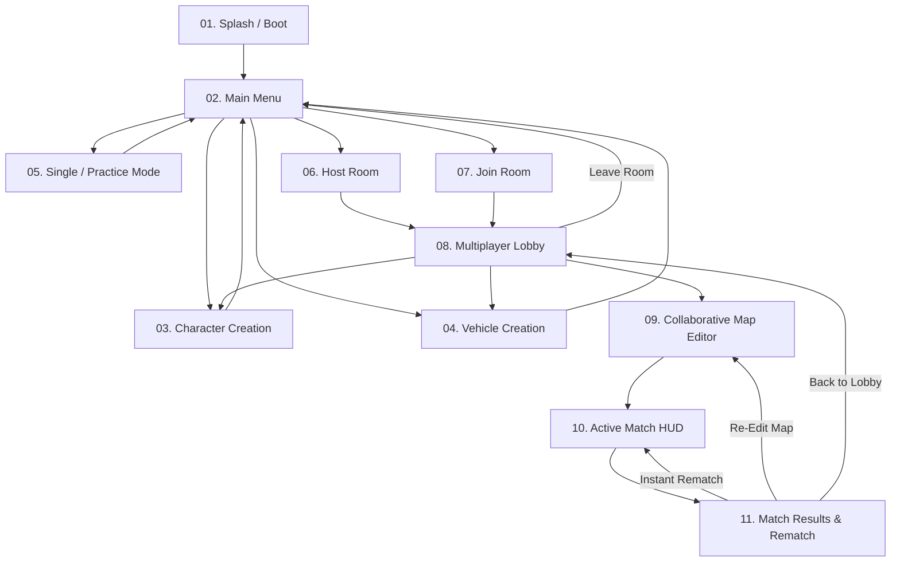

# Draw for Fight (D4F) — User Interface & User Experience Specification (`UI_UX.md`)

## 1. System Purpose
The UI/UX Subsystem (`res://scenes/ui/` and `res://scripts/ui/`) implements a playful, high-contrast "Sketchbook Arena" interface across all **11 mandatory screens**, ensuring effortless 2D drawing, clear 3D spatial readability, real-time multiplayer telemetry, full keyboard/mouse control ergonomics, and accessibility options.

---

## 2. Functional Requirements
- **FR-UI-01**: Provide 11 distinct, responsive UI screens adapting cleanly to 16:9 (`1280x720`, `1920x1080`, `2560x1440`) and 16:10 aspect ratios (`window/stretch/mode="canvas_items"`, `aspect="expand"`).
- **FR-UI-02**: Display live competitive stat bars (`Weight`, `Top Speed`, `Jump/Agility`, `Stability`, `Attack Power`) and a 360-degree interactive 3D preview viewport on both Character and Vehicle creation screens.
- **FR-UI-03**: Display real-time player ownership badges, remaining ink/prop budgets, and a prominent 60-second countdown bar in the Collaborative Map Editor.
- **FR-UI-04**: Render an uncluttered Active Match HUD showing mode-specific objectives (Lap/Checkpoint counter, Survival Stocks, or Battle KO Scoreboard), knockback warning indicators, speed/boost meter, and network security/ping badge.
- **FR-UI-05**: Support colorblind-friendly surface/team palettes, UI scale slider ($85\%..125\%$), and screen-shake reduction toggles in `SettingsManager`.

---

## 3. Non-Functional Requirements
- **Input Responsiveness**: Brush strokes on the 2D creation canvas must render with zero perceived lag ($< 16.6\text{ ms}$ frame-to-photon).
- **Visual Hierarchy**: Critical countdown timers (Last 10 seconds of Map Prep or Match Overtime) must pulse visually and trigger audio ticks so players are never caught off guard.

---

## 4. Inputs and Outputs
- **Inputs**: Keyboard shortcuts, mouse clicks/drags, scroll wheel zoom, and signals from `GameManager`, `MatchManager`, and `NetworkManager`.
- **Outputs**: Visual `Control` hierarchy updates, `SubViewport` 3D camera rotations, and audio feedback triggers via `AudioManager`.

---

## 5. Components and Responsibilities

### 5.1 Complete Specification of All 11 Screens

| # | Screen Name | Core UI Widgets & Layout | Key User Actions |
| :---: | :--- | :--- | :--- |
| **01** | **Splash / Boot Screen** | Animated D4F sketchbook logo, initialization progress bar, security identity status text. | Automatic transition (or press `Space`/`Enter` to skip animation). |
| **02** | **Main Menu** | Left navigation column (`Create Character`, `Create Vehicle`, `Practice / Solo AI`, `Host Room`, `Join Room`, `Settings`, `Quit`); Right 3D turntable showcase of active Character & Vehicle loadout; Profile nickname header. | Navigate to any subsystem; quick-switch active saved creations. |
| **03** | **Character Creation** | **Left Panel**: Tool palette (Brush, Eraser, Thickness slider, 16-color swatch, Zone selector: `Head`, `Torso`, `Arms`, `Legs`, `Weapon`). **Center**: $1024 \times 1024$ 2D Canvas with toggleable Stickman Ghost Guide & Symmetry line. **Right Panel**: Live 3D `SubViewport` turntable + 5 normalized Stat ProgressBars + `AIAssistantManager` helper buttons (`Symmetry`, `Smooth`, `Auto-Complete`, `Load Template`) + `Save & Exit`. | Sketch character, test animations (`Idle`, `Run`, `Jump`, `Attack`), save JSON. |
| **04** | **Vehicle Creation** | **Left Panel**: Zone selector (`Chassis`, `Front Wheels`, `Rear Wheels`, `Bumper`, `Cockpit`). **Center**: 2D Side/Profile Canvas with axle guide markers. **Right Panel**: 3D Suspension Drop-Test `SubViewport` + Vehicle Stat Bars (`Mass`, `Top Speed`, `Grip`, `Ram Power`, `Stability`) + `AI Auto-Wheel` helper + `Save & Exit`. | Sketch chassis & wheels, run 3D drop test, save JSON. |
| **05** | **Single / Practice Mode** | Top bar (`Switch Character/Vehicle`, `Spawn AI Bot`, `Cycle Mode Rule`, `Reset Arena`, `Return to Menu`) overlaid on live 3D practice arena. | Test creations against 1–7 offline AI bots with zero setup time. |
| **06** | **Host Room Screen** | Form controls: `Room Name`, `UDP Port (42424)`, `Room Password (Optional)`, `Max Players (2..8)`, `Default Competition Mode`, `Map Prep Duration (30s/60s/90s)`, `Enable LAN Broadcast` toggle, `Start Hosting` button. | Configure and launch authoritative Listen-Server. |
| **07** | **Join Room Screen** | **Tab 1 (LAN Browser)**: Auto-refreshing table of discovered LAN beacons (Room Name, Host, Mode, Players `N/8`, Ping `ms`, Lock icon). **Tab 2 (Direct IP / Relay Code)**: IP:Port input field, 6-char Relay Room Code input, Password prompt, `8-Layer Handshake Progress` modal. | Join a discovered LAN room or connect via IP/Relay. |
| **08** | **Multiplayer Lobby** | 8-slot Player Grid showing each peer's 3D creation preview, Nickname, Ping badge, Security Verified checkmark (`L8 Lock`), and `Ready` status; Host controls (`Add AI Bot`, `Select Mode`, `Start Collaborative Map Prep`). | Inspect rivals' creations, swap own loadout, toggle Ready. |
| **09** | **Collaborative Map Editor** | **Top**: Giant `60s Countdown Timer`, `Lock In Early` button, Mode Objective banner. **Left**: Tool mode switch (`Draw 2D Terrain` vs `Place 3D Object`), Surface selector (`Normal`, `Ice`, `Bounce`, `Boost`), Elevation slider, Prop catalog (`Ramp`, `Bumper`, `Sweeper`, `Crate`). **Bottom**: Personal Budget Meter (`Ink Remaining %`, `Props Left: 6/6`) + `Validate Map Now` indicator. | Collaboratively draw 3D paths and place hazards in real time. |
| **10** | **Active Match HUD** | **Top-Center**: Match Clock + Mode Banner (`Lap 2/3` / `Survivors: 4/8` / `Score Target: 10`). **Top-Right**: Live compact Leaderboard (Top 4 + Local Player rank). **Bottom-Left**: Entity status (Speedometer, Drift/Attack cooldown, Stability/Knockback gauge). **Bottom-Right**: Control hints & Ping/Encryption status pill. | Compete in 60 Hz 3D action; press `Tab` for full scoreboard or `Esc` for pause/reconnect menu. |
| **11** | **Match Results & Rematch** | 3D Podium spotlight displaying 1st, 2nd, and 3rd place custom creations performing victory animations; Full stat breakdown table (Score, Time, KOs, Awards); **20s Rematch Vote Bar** (`Instant Rematch` / `Re-Edit Map` / `Return to Lobby`). | Celebrate winner and vote for next round. |

### 5.2 Keyboard & Mouse Control Scheme
| Context | Input Binding | Action |
| :--- | :--- | :--- |
| **2D Creation Canvas** | `Left Mouse Drag` | Draw stroke in active zone |
| | `Right Mouse Drag` | Erase stroke points |
| | `Ctrl + Z` / `Ctrl + Y` | Undo / Redo stroke ($50$ steps) |
| | `Middle Mouse` / `Scroll` | Pan / Zoom 3D preview turntable |
| **Collaborative Map Editor** | `Left Mouse Drag` | Draw terrain spline or place selected 3D prop |
| | `Q` / `E` or `Scroll Wheel` | Rotate 3D prop ($15^\circ$ snap) or adjust terrain elevation |
| | `Right Mouse Click` | Delete own hovered terrain stroke or prop |
| | `WASD` + `Right Mouse Hold` | Pan and orbit 3D editor camera |
| **3D Gameplay (Character & Vehicle)** | `W, A, S, D` | Move character / Throttle, Steer, Reverse vehicle |
| | `Spacebar` | Jump (Character) / Handbrake & Hop (Vehicle) |
| | `Left Mouse Button (LMB)` | Melee Strike / Weapon Swing (Character) / Ram Boost (Vehicle) |
| | `Right Mouse Button (RMB)` | Dash / Shove (Character) / Secondary Ability |
| | `Left Shift` | Sprint (Character) / Drift & Charge Mini-Turbo (Vehicle) |
| | `R` (Hold $1.0\text{s}$) | Emergency Respawn at last valid checkpoint |
| | `V` | Toggle Camera Distance / Angle (Close Chase / Far Tactical) |

---

## 6. Internal Workflow (UI Screen Navigation & Modal State Machine)


---

## 7. Data Structures
- **`UIThemePalette` Constants**:
  ```gdscript
  const THEME_COLORS = {
      "bg_paper": Color("#1E222A"),
      "panel_card": Color("#282E3A"),
      "accent_primary": Color("#FF9F0A"),
      "accent_ready": Color("#30D158"),
      "accent_danger": Color("#FF453A"),
      "surface_normal": Color("#8E8E93"),
      "surface_ice": Color("#64D2FF"),
      "surface_bounce": Color("#BF5AF2"),
      "surface_boost": Color("#FFD60A")
  }
  ```

---

## 8. Dependencies
- Godot `Control`, `CanvasLayer`, `SubViewportContainer`, `SubViewport`, `Theme`.
- `SettingsManager` (UI scaling, colorblind mode, audio volume).
- `AudioManager` (UI button hover/click SFX).

---

## 9. Error Handling
- **Non-Blocking Toast & Modal Notifications**: Network disconnects, wrong room passwords, or `MapValidator` ownership rejections surface via a clean, auto-dismissing toast notification banner in `MainContainer/UILayer` rather than freezing the main thread with OS alert boxes.

---

## 10. Security Considerations
- **Input Field Sanitization**: Room names, player nicknames, and creation titles entered in `LineEdit` widgets are stripped of BBCode/HTML tags and clamped to $\le 32$ characters before display or network broadcast to prevent UI layout spoofing.

---

## 11. Performance Considerations
- **Viewport Update Mode Optimization**: The 3D turntable `SubViewport` in screens `03`, `04`, and `08` uses `UpdateMode.UPDATE_WHEN_VISIBLE` and automatically pauses rendering when hidden or when the user transitions into `10_active_match`.

---

## 12. Testing Strategy
- **UI Scene Load & Navigation Test (`tests/test_ui_screens.gd`)**: Instantiates all 11 screen scenes in headless mode, verifies all required buttons and viewports are bound without null references, and tests round-trip navigation signals.
