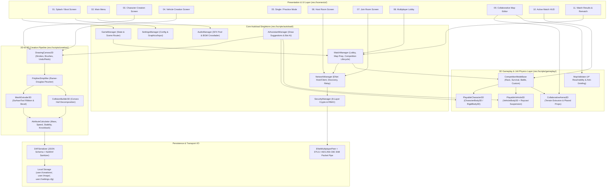

# 01. Overall Game Architecture

## Architectural Overview

Draw for Fight (D4F) employs a layered, modular architecture built on Godot Engine 4.x (`GL Compatibility` renderer + `Jolt Physics` 3D engine). Global state, networking, security, and match orchestration are managed by seven Autoload singletons that bridge the Presentation UI Layer, the Creative & Conversion Pipeline, the 3D Gameplay & Physics Engine, and the Authoritative Multiplayer & Security Transport Layer.

## Key Architectural Invariants
- **Strict Separation of Concerns**: UI screens never directly mutate network sockets or physics servers; all transitions pass through `GameManager`, `MatchManager`, and `NetworkManager`.
- **Deterministic Validation**: Every custom character, vehicle, and map modification is validated through `AttributeCalculator` and `MapValidator` on both client preview and authoritative host before spawning in 3D space.
- **Zero-Trust Network Boundary**: All packets traversing `ENetMultiplayerPeer` are authenticated, rate-limited, and verified by `SecurityManager` before reaching gameplay nodes.
