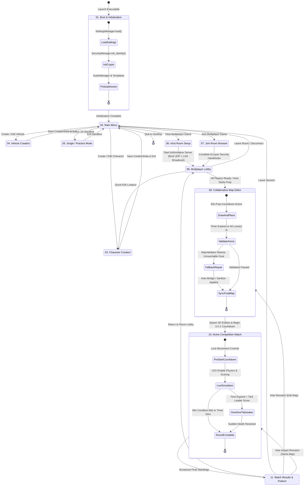

# 02. Main Gameplay Flow

## State Machine & Screen Flow

This diagram illustrates the complete player journey from booting the executable through creation, multiplayer room setup, collaborative map preparation, live 3D competition, and post-match rematch loops.

