# 03. Character Creation Pipeline

## End-to-End 2D Stickman Drawing to 3D Playable Fighter Flow

```mermaid
flowchart LR
    subgraph Input_Stage["1. 2D Template & Drawing Input"]
        TPL["Load Stickman Zone Template (Head, Torso, Arms, Legs, Weapon)"]
        BRUSH["Capture Freehand Pointer Strokes (Brush Color, Radius, Eraser)"]
        AI_SUG["AIAssistantManager Silhouette & Symmetry Hints"]
    end

    subgraph Vector_Stage["2. Vectorization & Simplification"]
        RAW["Raw Point Polylines (PackedVector2Array)"]
        BOUNDS["Zone Boundary Clipping & Anatomical Anchor Snapping"]
        RDP["Ramer-Douglas-Peucker Simplification (epsilon = 2.0px)"]
         BUDGET["Vertex Budget Enforcer (Max 512 Vertices / Creation)"]
    end

    subgraph Mesh_Stage["3. 3D Extrusion & Rig Binding"]
        RIBBON["SurfaceTool 3D Ribbon & Bevel Extrusion (Depth Z = 0.24m)"]
        NORM["Auto-Generate Smooth Normals, Tangents & Vertex Colors"]
        JOINTS["Bind Zone Meshes to Procedural Stickman Joint Pivots"]
    end

    subgraph Physics_Stage["4. Collision & Attribute Balancing"]
        CONVEX["Convex Hull Decomposition (Max 8 Hulls, <= 32 Verts/Hull)"]
        METRICS["Compute Ink Area, Aspect Ratio & Center of Mass Offset"]
        NORM_STAT["Normalize Competitive Stats (Mass, MaxSpeed, Jump, Knockback)"]
    end

    subgraph Output_Stage["5. Preview, Serialization & Spawn"]
        PREV["3D Turntable Viewport & Idle/Attack Animation Preview"]
        JSON["D4FSerializer -> user://creations/char_*.json"]
        SPAWN["Instantiate PlayableCharacter3D in Arena"]
    end

    TPL --> BRUSH
    AI_SUG -.-> BRUSH
    BRUSH --> RAW
    RAW --> BOUNDS
    BOUNDS --> RDP
    RDP --> BUDGET
    BUDGET --> RIBBON
    RIBBON --> NORM
    NORM --> JOINTS
    BUDGET --> CONVEX
    CONVEX --> METRICS
    METRICS --> NORM_STAT
    JOINTS --> PREV
    NORM_STAT --> PREV
    PREV --> JSON
    JSON --> SPAWN
```

## Pipeline Guarantees
- **Anatomical Continuity**: Disconnected limb strokes are automatically bridged to the nearest joint pivot (`Head->Neck`, `Shoulder->Torso`, `Hip->Torso`) using a damped spring constraint or fallback bone cylinder so characters never disintegrate unintentionally.
- **Zero Competitive Pay-to-Draw Bias**: Drawing a massive solid block maximizes `mass` and `stability` (high knockback resistance) but inversely penalizes `move_speed` and `jump_impulse`, keeping total power budget constant.
