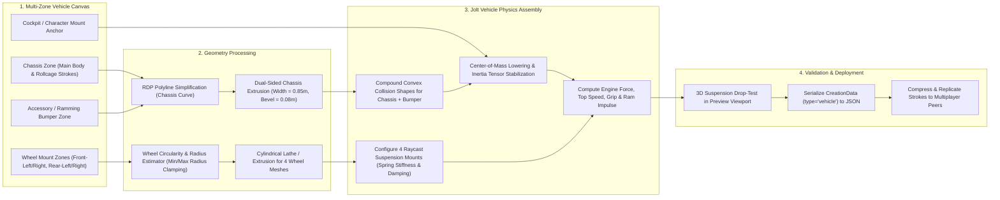

# 04. Vehicle Creation Pipeline

## End-to-End 2D Chassis & Wheel Sketching to 3D Raycast Vehicle Flow

## Vehicle Engineering Constraints
- **Wheel Fallback Synthesis**: If a player omits wheel strokes in the Wheel Zones, the pipeline synthesizes balanced default wheels (`radius = 0.35m`) so the vehicle remains drivable.
- **Anti-Roll Stabilization**: Custom-drawn tall vehicles automatically receive a downward Center-of-Mass clamp (`y_offset <= -0.15m` relative to chassis bounds) and anti-roll bar torque within `PlayableVehicle3D` to prevent frustrating tip-overs during sharp turns.
