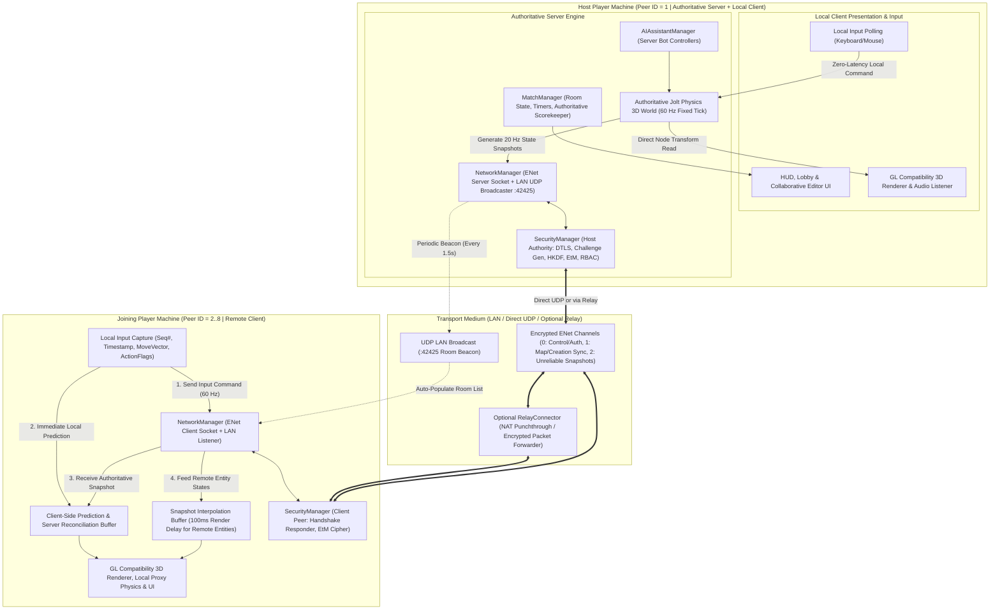

# 07. Host and Joining Player Architecture

## Self-Hosted Listen-Server (Host-as-Player) vs. Joining Client Topology

## Topology Highlights
- **No Dedicated Server Required**: Any player clicking **Host Room** starts an embedded authoritative server (`Peer ID = 1`) while simultaneously playing locally in the same process.
- **Anti-Host-Advantage Fairness**: Although the Host has zero network RTT, local host input is queued into the exact same 60 Hz physics tick buffer and subject to the same `AttributeCalculator` movement caps and cooldown timers as remote clients.
- **Channel Segregation**:
  - `Channel 0` (Reliable Ordered): 8-Layer Security Handshake, Lobby state transitions, Match lifecycle events.
  - `Channel 1` (Reliable Ordered, Chunked): Custom Character/Vehicle `CreationData` and Collaborative Map deltas.
  - `Channel 2` (Unreliable Sequenced): High-frequency 60 Hz client input frames and 20 Hz server physics snapshots.
